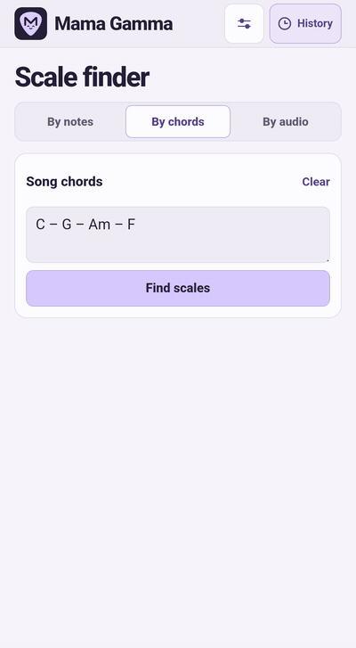
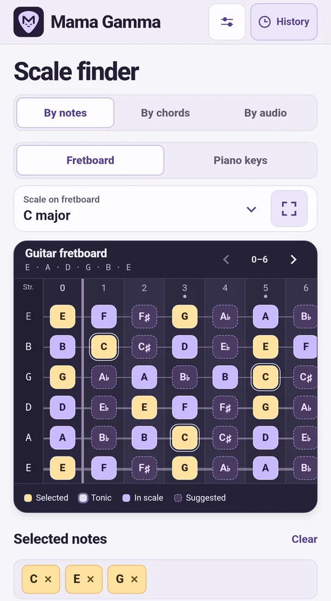
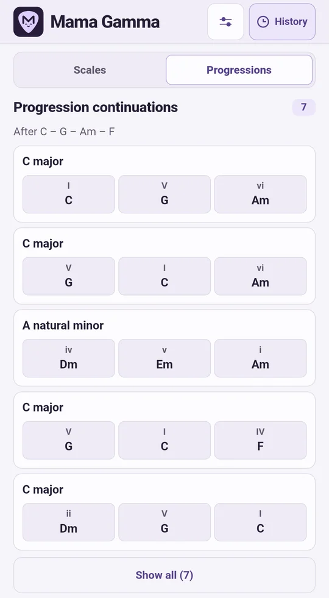
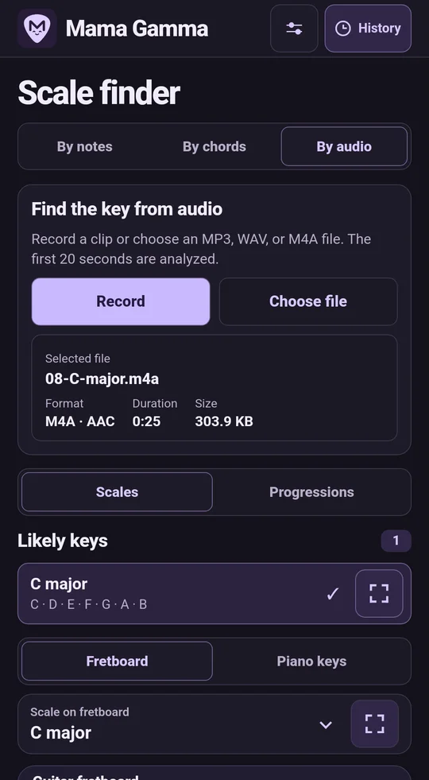
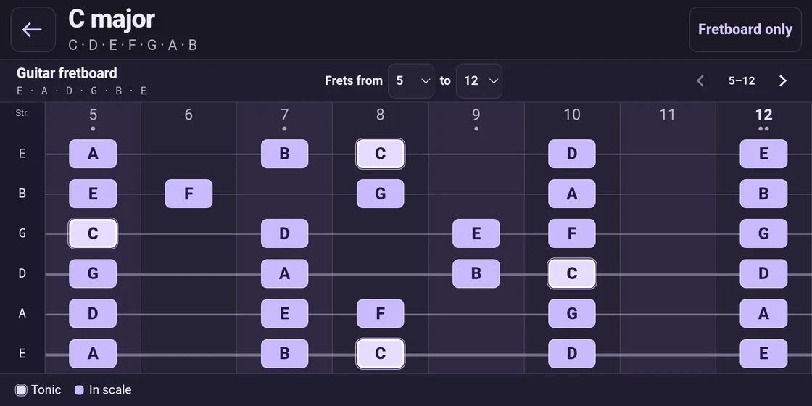
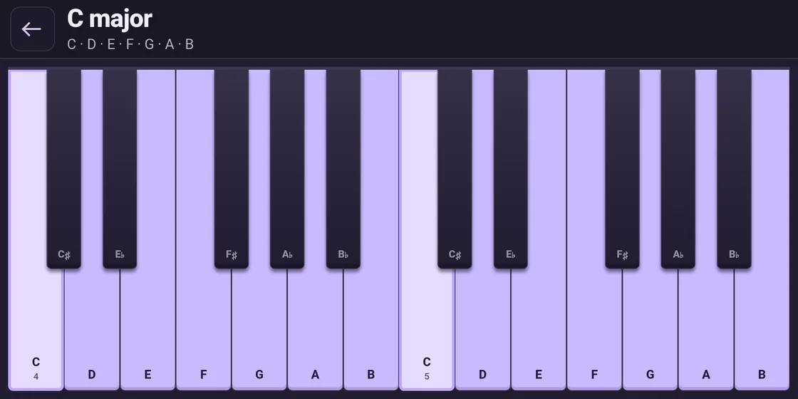
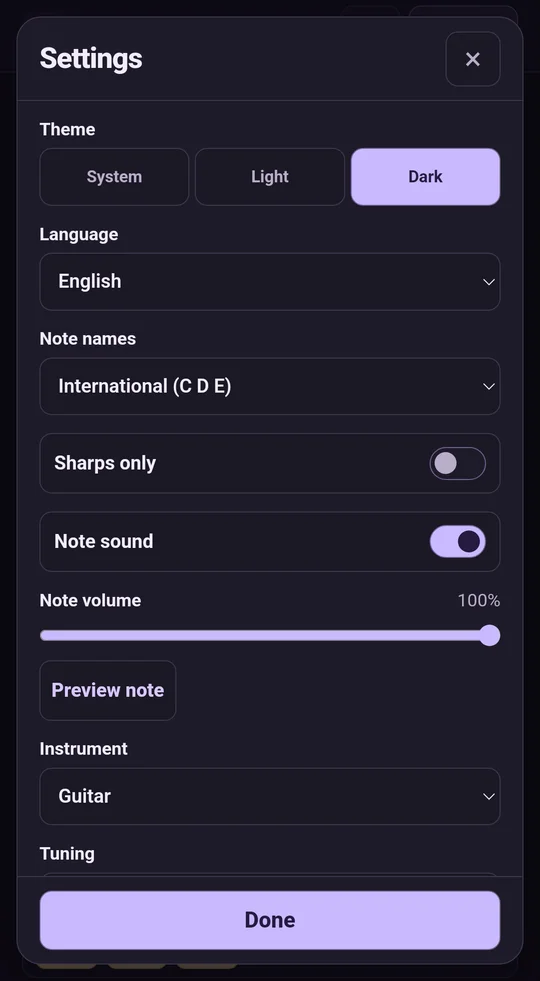
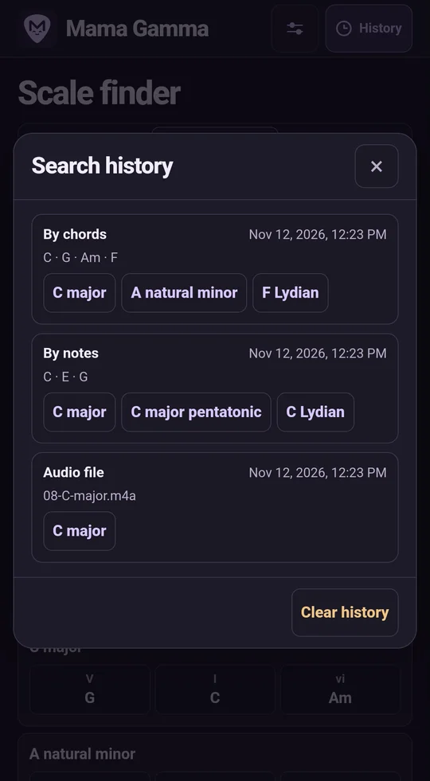

<p align="center">
  
</p>

<p align="center">
  Find the key from notes, chords, or audio and play the scale on a fretboard or piano keys.
</p>

<p align="center">
  <strong>Version 1.12.0</strong> · Android 8.0 and later · Works offline
</p>

<p align="center">
  <strong><a href="https://github.com/MLEX0/MamaGamma/releases/download/v1.12.0/Mama-Gamma-1.12.0.apk">Download APK</a></strong> ·
  <a href="https://github.com/MLEX0/MamaGamma/releases/tag/v1.12.0">Release notes</a>
</p>

<p align="center">
  <strong>English</strong> ·
  <a href="docs/readme/README.ru.md">Русский</a> ·
  <a href="docs/readme/README.de.md">Deutsch</a> ·
  <a href="docs/readme/README.es.md">Español</a> ·
  <a href="docs/readme/README.fr.md">Français</a> ·
  <a href="docs/readme/README.uk.md">Українська</a> ·
  <a href="docs/readme/README.ja.md">日本語</a> ·
  <a href="docs/readme/README.zh.md">简体中文</a>
</p>

<p align="center">
  <a href="#install">Install</a> ·
  <a href="#quick-start">Quick start</a> ·
  <a href="#find-a-scale">Find a scale</a> ·
  <a href="#fretboard-and-settings">Fretboard and settings</a>
</p>

## Quick start

1. Open **By chords** and enter `C – G – Am – F`.
2. Tap **Find scales**. Select **C major** in the results to highlight its notes on the fretboard.
3. Tap the expand button next to a result or double-tap its name. The fretboard opens in landscape.

> The example uses the default International note names. To match the English labels in this guide, open **Settings → Language → English**.

<details>
<summary>Watch a chord search</summary>

<p align="center">
  
</p>

</details>

## Find a scale

| What you have | Where to start | What you get |
| --- | --- | --- |
| A few notes from a melody | **By notes** | Scales that contain those notes and suggestions for the next note |
| The chords of a song | **By chords** | Scales that fit the progression, with any out-of-scale chords listed |
| A riff, recording, or song | **By audio** | Up to three likely major or minor keys |

### By notes

Tap notes such as **C**, **E**, and **G**. Switch between **Fretboard** and **Piano keys** to choose how you enter notes and view scales. Each selection applies across octaves. Tap a note or its chip again to remove it.

| Legend | Meaning |
| --- | --- |
| **Selected** | The note is part of the search |
| **Tonic** | The first degree of the displayed scale |
| **In scale** | The note belongs to the displayed scale |
| **Suggested** | Adding the note would still match another candidate scale |

### Chord progressions from notes

In **By notes**, select one or more notes on the fretboard or piano keys, then switch the results to **Progressions**. The app suggests chord progressions in major and natural minor keys. Every selected note appears in at least one chord of each result and is listed below the chords it belongs to.

### By chords

Paste a progression, such as `Dm7 | G7 | Cmaj7`, and tap **Find scales**. You can separate chords with spaces, dashes, vertical bars, or line breaks. If the progression has no exact match, the app lists the closest scales and identifies the chords outside each one. Use **Clear chords** to empty the input and results.

Open **Progressions** in the results to see what could come next. For example, `C` can follow `Dm7 – G7`.

### By audio

| Source | How to start |
| --- | --- |
| **Microphone** | Tap **Record**, allow microphone access, and play a short phrase. Tap **Stop and analyze** to finish early. |
| **File** | Tap **Choose file** and open an MP3, WAV, or AAC-encoded M4A file. |
| **Telegram or another app** | Open Android's **Share** menu for an audio file and choose **Mama Gamma**. Analysis starts automatically. |

The app analyzes up to 20 seconds on your device and shows available file details. If it returns several keys, open each scale and compare it with what you hear. For a quiet or short clip, try a passage with several clear notes or chords.

Once analysis finishes, open **Progressions** for harmony ideas in the estimated keys.

<p align="center">
  
  
  
</p>

## Fretboard and settings

### Practice a scale

1. Tap a result once to preview its notes, or open it full screen with the expand button or a double-tap.
2. In **Fretboard** mode, set the first and last fret, for example **5–12**. Swipe or use the arrows to move along the fretboard.
3. Tap **Fretboard only** for a larger playing area. The **⋯** button in the top-left corner or Android **Back** brings back the controls.

Tap a highlighted note to hear its pitch. The fretboard follows the selected instrument and tuning.

<p align="center">
  
</p>

In **Piano keys** mode, the full-screen view highlights the scale across the keyboard.

<p align="center">
  
</p>

### Change language and note names

**Settings → Language** follows Android by default and falls back to English if none of the system's languages are supported. Choose English, Russian, German, Spanish, French, Ukrainian, Japanese, or Simplified Chinese to override it.

**Settings → Note names** controls the notation separately. It applies to the fretboard, piano keys, scale names, open-string tuning, and chord input. Turn on **Sharps only** to spell note names and chord roots with sharps, such as D♯ in place of E♭.

| Note names | Natural notes, starting at C |
| --- | --- |
| **International** | C, D, E, F, G, A, B |
| **German** | C, D, E, F, G, A, H. In this notation, B means B♭. |
| **Solfège** | Do, Re, Mi, Fa, Sol, La, Si |
| **Cyrillic solfège** | До, Ре, Ми / Мі, Фа, Соль, Ля, Си / Сі |
| **Japanese** | ハ, ニ, ホ, ヘ, ト, イ, ロ |

With Solfège selected, the quick-start progression reads `Do – Sol – Lam – Fa`. Chord suffixes such as `m`, `maj7`, and `sus4` work across all five systems.

### Make it yours

- **Instrument and tuning.** Choose guitar, bass, ukulele, or mandolin. Use a preset or set open strings by hand, with 12 to 36 frets per instrument.
- **Note sound.** Set the volume or turn it off. A volume change or **Preview note** plays the next degree of the selected scale and loops back to the tonic.
- **Theme.** Choose light, dark, or system.
- **Reset settings.** Restore the defaults, including language and note names. Find the app version at the bottom of Settings.

### Reopen a past search

Tap **History** in the top bar to see the last 100 successful searches on your device. Each entry shows the time, search method, and up to three scales. Consecutive identical note or chord searches create one entry. Tap a scale to open it on the fretboard, or use **Clear history** to delete the entries.

<p align="center">
  
  
</p>

## Install

### Install an APK

1. Download `Mama-Gamma-1.12.0.apk` above on your Android device. If you built the app, copy `app-debug.apk` to the device.
2. Open the file. If Android prompts you, allow installs from the app you used to open it. [Android installation help](https://support.google.com/pixelphone/answer/7391672)
3. Tap **Install**, then open **Mama Gamma**.

### Build from source

1. Install Android Studio. In SDK Manager, add **Android SDK Platform 35** and **Android SDK Build-Tools 35.0.0**. Use **JDK 17** to run Gradle. [Android Studio](https://developer.android.com/studio) · [SDK Manager](https://developer.android.com/studio/intro/update#sdk-manager) · [Android Gradle Plugin compatibility](https://developer.android.com/build/releases/agp-8-11-0-release-notes)
2. Clone the repository and enter its directory.

   ```sh
   git clone https://github.com/MLEX0/MamaGamma.git
   cd MamaGamma
   ```

3. Open the project in Android Studio to set up the SDK path. When building from a terminal, you can set `ANDROID_HOME` to your installed SDK directory.
4. Run the command for your system from the repository root. The first build needs internet access to download Gradle and its dependencies.

   **Windows PowerShell**

   ```powershell
   .\gradlew.bat :app:assembleDebug
   ```

   **Linux and macOS**

   ```sh
   ./gradlew :app:assembleDebug
   ```

5. Install `app/build/outputs/apk/debug/app-debug.apk`. [Build Android apps from the command line](https://developer.android.com/build/building-cmdline)

<details>
<summary>Install over USB with ADB</summary>

Enable USB debugging, connect your phone, and approve the connection on the device. Run these commands from the repository root. Android SDK Platform-Tools includes `adb`.

```sh
adb devices
adb install -r app/build/outputs/apk/debug/app-debug.apk
```

To update an existing install, use an APK signed with the same key. Uninstalling the app removes its local settings and history. [ADB documentation](https://developer.android.com/tools/adb)

</details>

## For developers

- The UI, fretboard, and scale finder live in the [app assets](app/src/main/assets/).
- Recording and audio decoding run in the [Android code](app/src/main/java/app/gammama/scales/).
- The [audio analysis research notes](docs/audio-scale-research.md) describe the design and alternatives in Russian.
