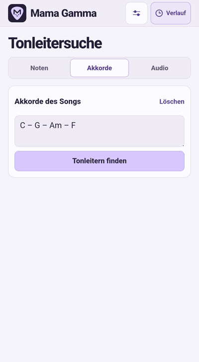
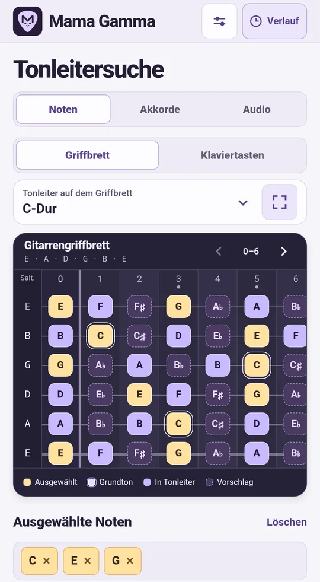
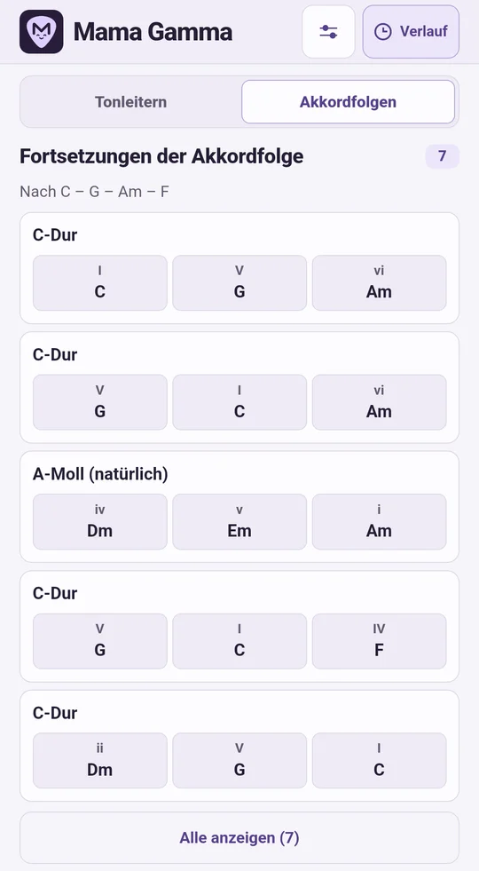
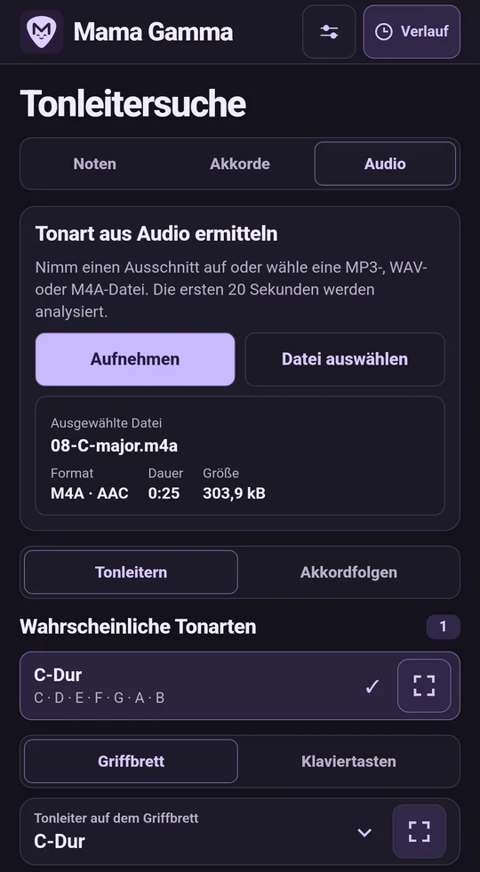
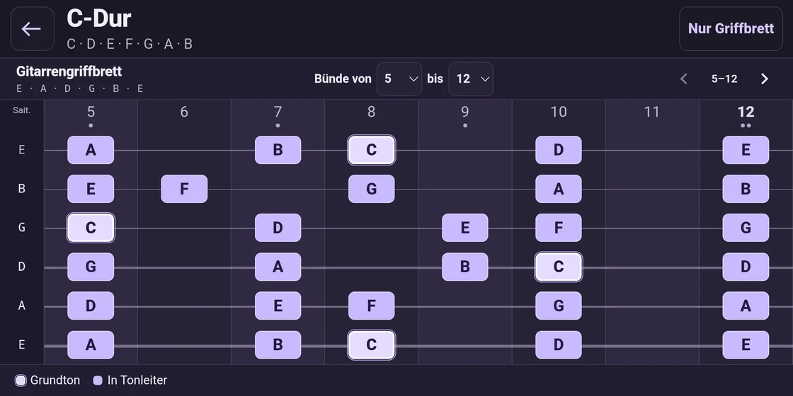
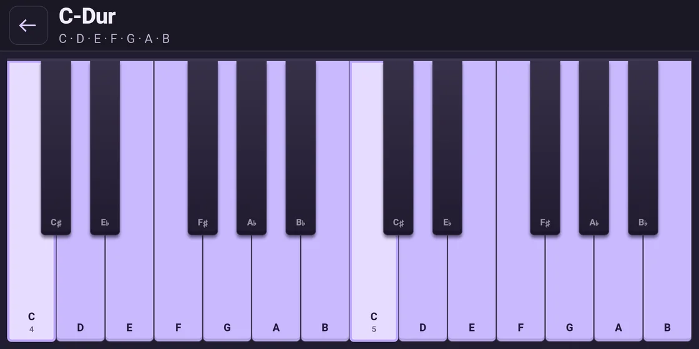
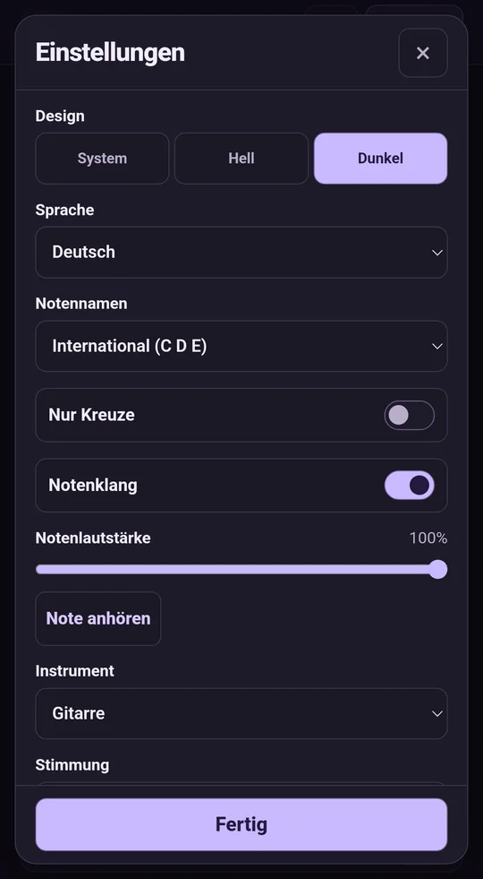
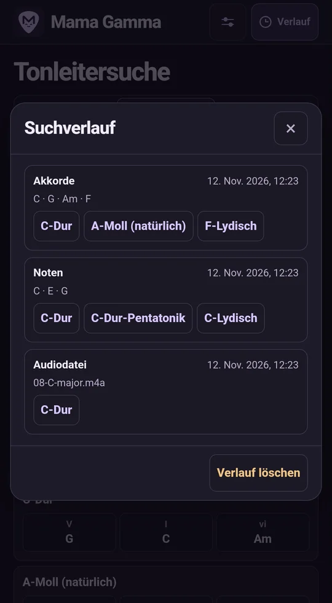

<p align="center">
  
</p>

<p align="center"><a href="../../README.md">English</a> · <a href="README.ru.md">Русский</a> · <strong>Deutsch</strong> · <a href="README.es.md">Español</a> · <a href="README.fr.md">Français</a> · <a href="README.uk.md">Українська</a> · <a href="README.ja.md">日本語</a> · <a href="README.zh.md">简体中文</a></p>

# Mama Gamma

Finde Tonleitern anhand von Noten, Akkorden oder Audio. Übe die Tonleitern auf dem virtuellen Griffbrett oder den Klaviertasten.

**Version 1.13.0** · Android 8.0 oder neuer · Analyse auf dem Gerät

<p align="center">
  <strong><a href="https://github.com/MLEX0/MamaGamma/releases/download/v1.13.0/Mama-Gamma-1.13.0.apk">APK herunterladen</a></strong> ·
  <a href="https://github.com/MLEX0/MamaGamma/releases/tag/v1.13.0">Versionshinweise</a>
</p>

## Schnellstart

1. Öffne **Akkorde** und gib `C – G – Am – F` mit internationalen Notennamen ein.
2. Tippe auf **Tonleitern finden** und wähle **C-Dur**.
3. Tippe zweimal auf den Namen der Tonleiter oder einmal auf die Schaltfläche rechts daneben, um das Griffbrett im Vollbild zu öffnen.

<details>
<summary>Akkordsuche ansehen</summary>

<p align="center"></p>

</details>

## Tonleitern finden

- **Noten.** Tippe auf die Töne einer Melodie. Wechsle bei Bedarf zwischen **Griffbrett** und **Klaviertasten**. Die ausgewählte Note wird in allen Oktaven markiert. Tippe erneut darauf, um die Auswahl aufzuheben. Vorschläge zeigen, welche Töne du hinzufügen kannst.
- **Akkordfolgen aus Noten.** Wähle unter **Noten** einen oder mehrere Töne und wechsle in den Ergebnissen zu **Akkordfolgen**. Die App schlägt Akkordfolgen in Dur und natürlichem Moll vor. Jeder gewählte Ton kommt in mindestens einem Akkord pro Folge vor und wird unter den passenden Akkorden angezeigt.
- **Akkorde.** Gib Akkorde wie `Dm7 | G7 | Cmaj7` ein. Verwende Leerzeichen, Gedankenstriche, senkrechte Striche oder Zeilenumbrüche als Trennzeichen. Gibt es keine exakte Übereinstimmung, zeigt die App die nächsten Treffer und markiert Akkorde außerhalb der Tonleiter. Tippe auf **Tonleitern finden** und öffne in den Ergebnissen **Akkordfolgen**, um Vorschläge für die nächsten Akkorde zu sehen. Auf `Dm7 – G7` kann zum Beispiel `C` folgen. Tippe auf einen Akkord, um ihn anzuhören und seine Töne zu sehen. **Akkordfolge spielen** hebt beim Abspielen den aktuellen Akkord hervor.
- **Audio.** Tippe auf **Aufnehmen**. Wellenform und Timer laufen während der bis zu zwei Minuten langen Aufnahme mit. Tippe auf **Stoppen und analysieren** und dann auf **WAV speichern**, um die Aufnahme zu behalten. Öffne über **Datei auswählen** eine MP3-, WAV- oder AAC-kodierte M4A-Datei oder verwende **Teilen → Mama Gamma** in einer anderen App.
- **Ausschnitt wählen.** Die erste Analyse beginnt am Dateianfang und umfasst bis zu 20 Sekunden. Verschiebe die Auswahl auf der Wellenform, ziehe an einem Rand oder gib Start und Ende ein. Mit **+** und **−** änderst du den Maßstab. Wähle höchstens 20 Sekunden und tippe auf **Ausschnitt analysieren**. Bei langen Dateien erscheint die Wellenform nach und nach.
- **Audioergebnisse.** Die App zeigt bis zu drei wahrscheinliche Tonarten und eine Folge erkannter dominanter Töne mit Zeitangaben. Eine einzelne Stimme oder ein Instrument lässt sich besser erkennen. Öffne **Akkordfolgen** für Begleitideen oder tippe auf **Löschen**, um die aktuelle Suche zurückzusetzen.

<p align="center">
  
  
  
</p>

## Werkzeuge

Wechsle in der unteren Leiste zwischen **Tonleitersuche** und **Werkzeuge**. Die Suchergebnisse bleiben erhalten.

- **Akkordbibliothek.** Suche nach einem Akkordsymbol oder wähle Grundton und Akkordtyp. Wähle einen Basston für eine Umkehrung. Sieh dir die verfügbaren Griffe für Gitarre, Bass, Ukulele, Mandoline und Klavier an und höre sie dir an. Bei Saiteninstrumenten entsprechen die Griffe der Stimmung, und die Töne setzen leicht versetzt ein.
- **Stimmgerät.** Tippe auf **Mikrofon einschalten**. Stimme chromatisch oder wähle eine Saite des aktuellen Instruments. Die Anzeige zeigt Ton, Frequenz und Abweichung in Cent.

## Griffbrett und Einstellungen

Tippe einmal auf einen Treffer, um die Tonleiter auf dem Hauptgriffbrett zu markieren. Lege im Vollbild einen Bundbereich wie **5–12** fest. Wische über das Griffbrett oder bewege es mit den Pfeilen. **Nur Griffbrett** blendet Bedienleiste und Legende aus. **⋯** oder die Android-Zurück-Funktion bringt die Bedienelemente zurück.

<p align="center"></p>

Unter **Klaviertasten** hebt die Vollbildansicht die Töne der Tonleiter auf der Klaviatur hervor.

<p align="center">
  
</p>

**Abspielen** spielt die Tonleiter bis zum nächsten Grundton und markiert die erklingenden Töne. In den Einstellungen kannst du 50 bis 180 BPM, die Startoktave und eine bis fünf Oktaven wählen. Wische über die Tasten oder tippe auf einen Oktavbereich, um ihn anzuzeigen.

- **Instrument und Stimmung.** Wähle Gitarre, Bass, Ukulele oder Mandoline. Stelle die leeren Saiten ein und wähle 12 bis 36 Bünde.
- **Klang und Design.** Regle die Lautstärke der Noten, schalte sie stumm oder wähle ein helles, dunkles oder systemgesteuertes Design. **Note anhören** spielt die nächste Stufe der aktuellen Tonleiter.
- **Sprache.** Die Oberfläche ist auf Englisch, Russisch, Deutsch, Spanisch, Französisch, Ukrainisch, Japanisch und vereinfachtem Chinesisch verfügbar. Standardmäßig verwendet die App die erste unterstützte Android-Sprache. Falls keine davon unterstützt wird, erscheint die App auf Englisch.
- **Notennamen.** Die Wahl ist unabhängig von der Sprache. Verfügbar sind international **C D E**, deutsch **C D E … H** (**B** steht für B♭), Solfège **Do Re Mi**, kyrillisch **До Ре Ми** und japanisch **ハ ニ ホ**. Aktiviere **Nur Kreuze**, damit Notennamen und Akkordgrundtöne mit Kreuzen angezeigt werden, etwa D♯ statt E♭.
- **Verlauf.** In der oberen Leiste findest du die letzten 100 erfolgreichen Suchen. Tippe auf eine Tonleiter, um sie erneut zu öffnen. Verlauf löschen und Einstellungen zurücksetzen sind getrennte Aktionen.

<p align="center">
  
  
</p>

## Installation und Build

### Fertige APK installieren

Lade `Mama-Gamma-1.13.0.apk` über den Link oben auf dein Android-Gerät. Wenn du die App selbst erstellt hast, übertrage `app-debug.apk`. Öffne die Datei, tippe auf **Installieren** und starte Mama Gamma. Wenn Android nach einer Berechtigung fragt, erlaube der App, mit der du die APK öffnest, die Installation aus dieser Quelle.

### APK aus dem Quellcode erstellen

Installiere **Android SDK Platform 35**, **Android SDK Build-Tools 35.0.0** und **JDK 17**. Öffne das Projekt in Android Studio oder gib den SDK-Pfad über `ANDROID_HOME` an. Für den ersten Build brauchst du eine Internetverbindung. [Android Studio](https://developer.android.com/studio) · [Android Gradle Plugin](https://developer.android.com/build/releases/agp-8-11-0-release-notes)

```sh
git clone https://github.com/MLEX0/MamaGamma.git
cd MamaGamma
```

**Windows PowerShell**

```powershell
.\gradlew.bat :app:assembleDebug
```

**Linux / macOS**

```sh
./gradlew :app:assembleDebug
```

**Erstellte APK** — `app/build/outputs/apk/debug/app-debug.apk`.

<details>
<summary>Installation mit ADB</summary>

Aktiviere USB-Debugging, verbinde das Gerät und bestätige die Anfrage auf dem Bildschirm. Führe den Befehl im Projektverzeichnis mit installierten Android SDK Platform-Tools aus.

```sh
adb devices
adb install -r app/build/outputs/apk/debug/app-debug.apk
```

</details>

[Hintergrund zur Audioanalyse](../audio-scale-research.md)
