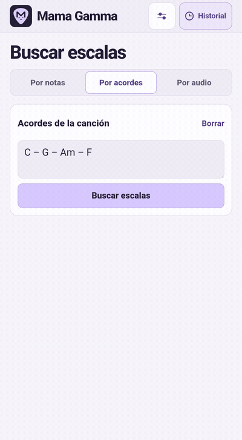
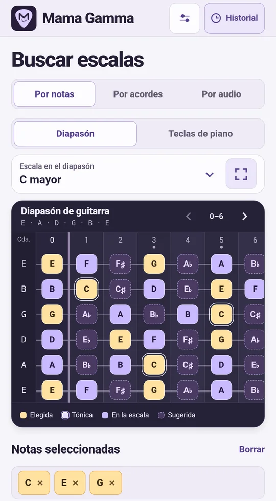
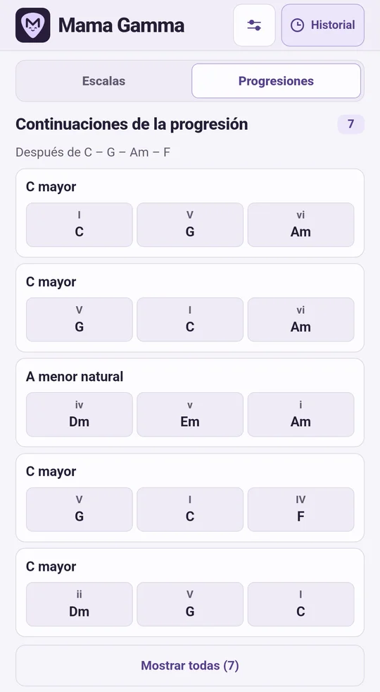
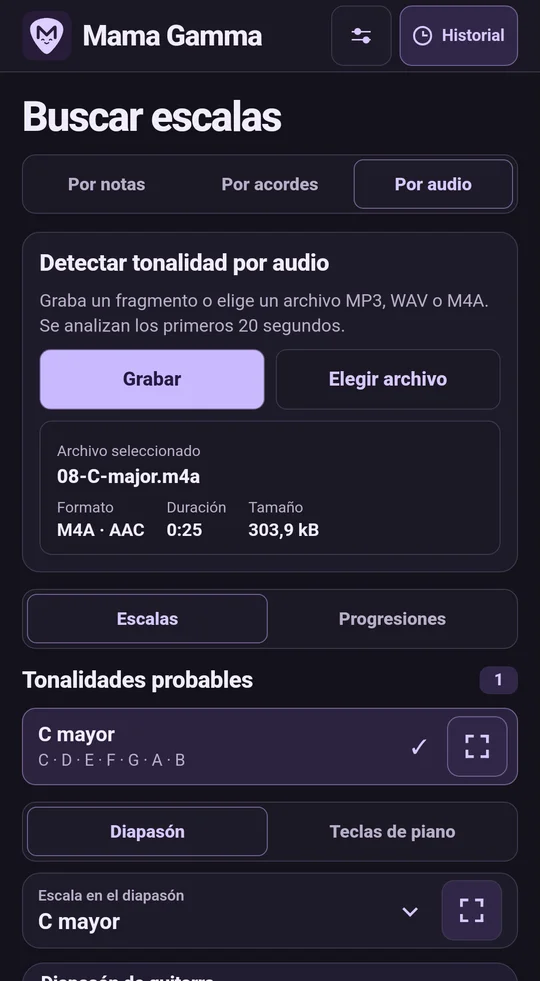
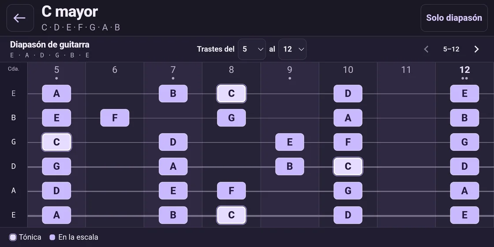
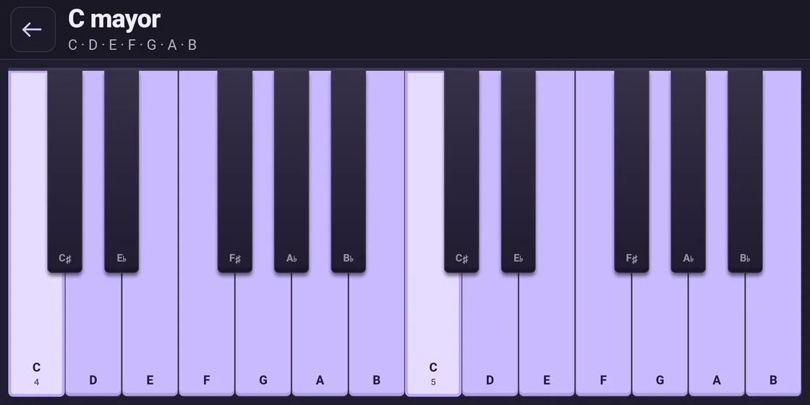
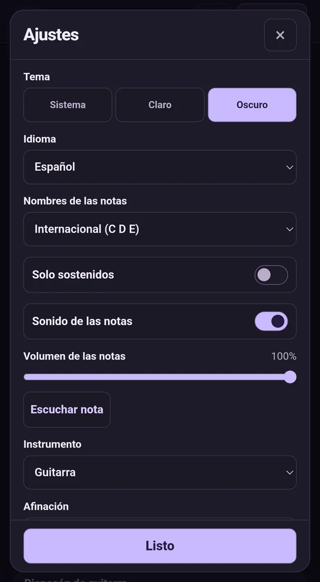
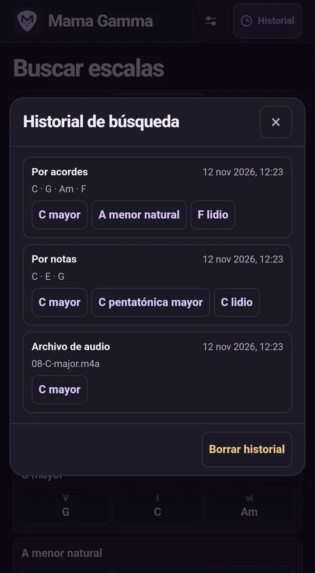

<p align="center">
  
</p>

<p align="center"><a href="../../README.md">English</a> · <a href="README.ru.md">Русский</a> · <a href="README.de.md">Deutsch</a> · <strong>Español</strong> · <a href="README.fr.md">Français</a> · <a href="README.uk.md">Українська</a> · <a href="README.ja.md">日本語</a> · <a href="README.zh.md">简体中文</a></p>

# Mama Gamma

Encuentra escalas a partir de notas, acordes o audio. Practica las escalas en el diapasón virtual o en las teclas de piano.

**Versión 1.12.0** · Android 8.0 o posterior · Análisis en el dispositivo

<p align="center">
  <strong><a href="https://github.com/MLEX0/MamaGamma/releases/download/v1.12.0/Mama-Gamma-1.12.0.apk">Descargar APK</a></strong> ·
  <a href="https://github.com/MLEX0/MamaGamma/releases/tag/v1.12.0">Notas de la versión</a>
</p>

## Inicio rápido

1. Abre **Por acordes** e introduce `C – G – Am – F` con los nombres internacionales de las notas.
2. Toca **Buscar escalas** y selecciona **C mayor**.
3. Toca dos veces el nombre de la escala o una vez el botón a su derecha para abrir el diapasón a pantalla completa.

<details>
<summary>Ver una búsqueda por acordes</summary>

<p align="center"></p>

</details>

## Buscar escalas

- **Por notas.** Toca las notas de una melodía. Cambia entre **Diapasón** y **Teclas de piano** para elegir cómo introducir notas y ver escalas. Cada nota elegida se resalta en todas las octavas. Tócala otra vez para quitarla. Las sugerencias indican qué notas puedes añadir.
- **Progresiones a partir de notas.** En el modo **Por notas**, selecciona una o varias notas y cambia a **Progresiones** en los resultados. La aplicación sugiere progresiones en tonalidades mayores y menores naturales. Cada nota elegida aparece en al menos un acorde de cada progresión y se muestra debajo de los acordes que la contienen.
- **Por acordes.** Introduce acordes como `Dm7 | G7 | Cmaj7`. Puedes separarlos con espacios, rayas, barras verticales o saltos de línea. Si no hay coincidencia exacta, aparecen las escalas más cercanas y los acordes que quedan fuera de ellas. Toca **Buscar escalas** y abre **Progresiones** en los resultados para ver cómo seguir. Por ejemplo, `Dm7 – G7` puede continuar con `C`.
- **Por audio.** Toca **Grabar** y después **Detener y analizar**. También puedes abrir un archivo MP3, WAV o M4A con AAC desde **Elegir archivo**. Desde otra aplicación, usa **Compartir → Mama Gamma**. Se analizan los primeros 20 segundos y se muestran hasta tres tonalidades mayores o menores probables. Abre **Progresiones** después del análisis para ver ideas de acompañamiento en esas tonalidades.

<p align="center">
  
  
  
</p>

## Diapasón y ajustes

Toca un resultado una vez para resaltarlo en el diapasón principal. En pantalla completa, elige un rango de trastes, por ejemplo **5–12**, y desplázate con un gesto o con las flechas. **Solo diapasón** oculta la barra y la leyenda. El botón **⋯** o la acción **Atrás** de Android vuelve a mostrar los controles.

<p align="center"></p>

Con **Teclas de piano**, la vista a pantalla completa resalta las notas de la escala en el teclado.

<p align="center">
  
</p>

- **Instrumento y afinación.** Elige guitarra, bajo, ukelele o mandolina. Ajusta las cuerdas al aire y selecciona entre 12 y 36 trastes.
- **Sonido y tema.** Regula el volumen de las notas, siléncialas o selecciona un tema claro, oscuro o del sistema. **Escuchar nota** reproduce el siguiente grado de la escala actual.
- **Idioma.** La interfaz está disponible en inglés, ruso, alemán, español, francés, ucraniano, japonés y chino simplificado. La aplicación usa por defecto el primer idioma de Android que admite. Si no hay ninguno, se abre en inglés.
- **Nombres de las notas.** Se eligen por separado del idioma de la interfaz. Puedes usar el sistema internacional **C D E**, alemán **C D E … H** (**B** es si bemol), solfeo **Do Re Mi**, cirílico **До Ре Ми** o japonés **ハ ニ ホ**. Activa **Solo sostenidos** para mostrar los nombres de las notas y las fundamentales de los acordes con sostenidos, como D♯ en lugar de E♭.
- **Historial.** La barra superior da acceso a las últimas 100 búsquedas con resultados. Toca una escala para volver a abrirla. Borrar el historial y restablecer los ajustes son acciones independientes.

<p align="center">
  
  
</p>

## Instalación y compilación

### Instalar el APK

Descarga `Mama-Gamma-1.12.0.apk` en tu dispositivo Android con el enlace de arriba. Si has compilado la aplicación, copia `app-debug.apk` al dispositivo. Abre el archivo, toca **Instalar** e inicia Mama Gamma. Si Android solicita permiso, autoriza la instalación desde la aplicación con la que abriste el APK.

### Compilar el APK desde el código fuente

Instala **Android SDK Platform 35**, **Android SDK Build-Tools 35.0.0** y **JDK 17**. Abre el proyecto en Android Studio o indica la ruta del SDK mediante `ANDROID_HOME`. La primera compilación requiere conexión a Internet. [Android Studio](https://developer.android.com/studio) · [Android Gradle Plugin](https://developer.android.com/build/releases/agp-8-11-0-release-notes)

```sh
git clone https://github.com/MLEX0/MamaGamma.git
cd MamaGamma
```

**Windows PowerShell**

```powershell
.\gradlew.bat :app:assembleDebug
```

**Linux / macOS**

```sh
./gradlew :app:assembleDebug
```

**APK compilado** — `app/build/outputs/apk/debug/app-debug.apk`.

<details>
<summary>Instalación con ADB</summary>

Activa la depuración por USB, conecta el dispositivo y acepta la solicitud en su pantalla. Ejecuta el comando desde la raíz del proyecto con Android SDK Platform-Tools instalado.

```sh
adb devices
adb install -r app/build/outputs/apk/debug/app-debug.apk
```

</details>

[Investigación sobre el análisis de audio](../audio-scale-research.md)
