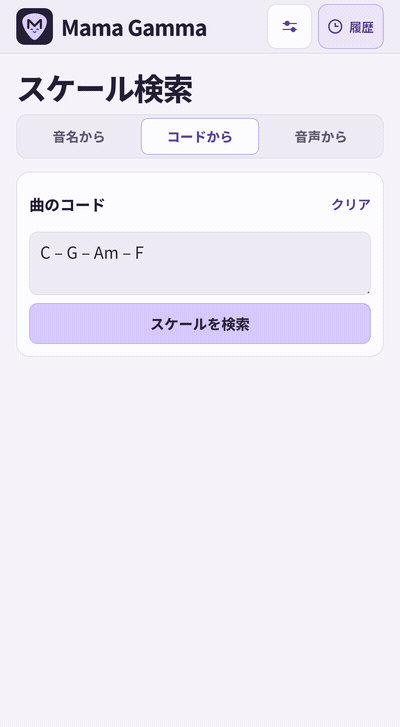
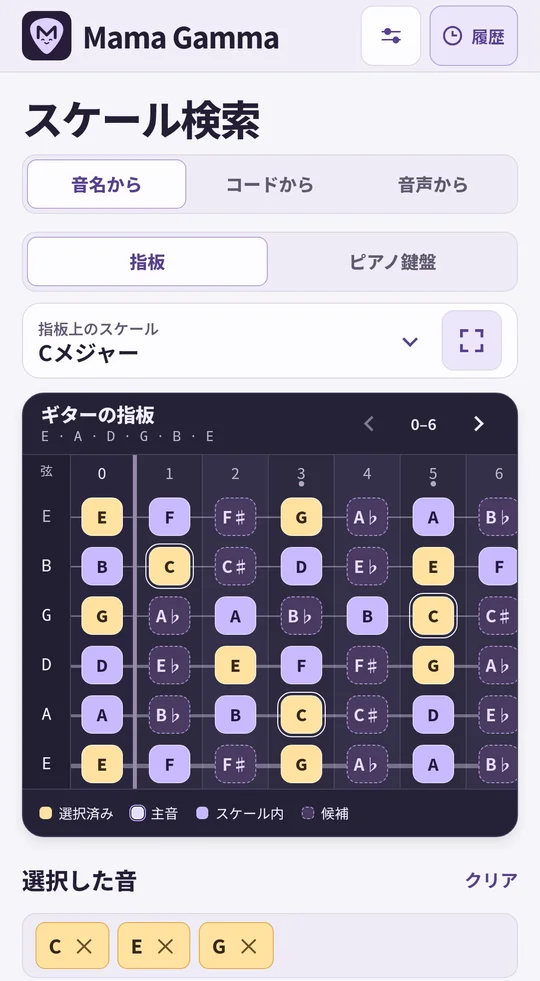
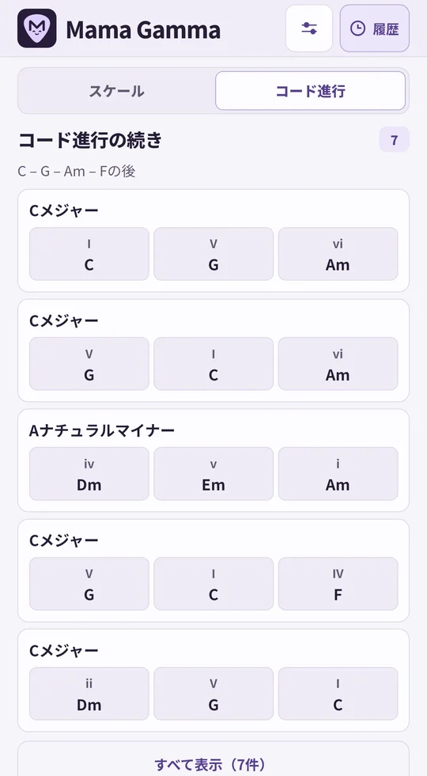
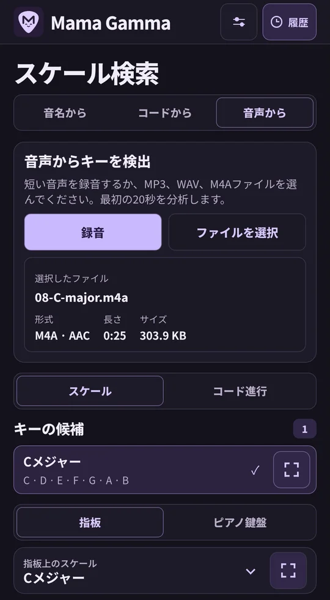
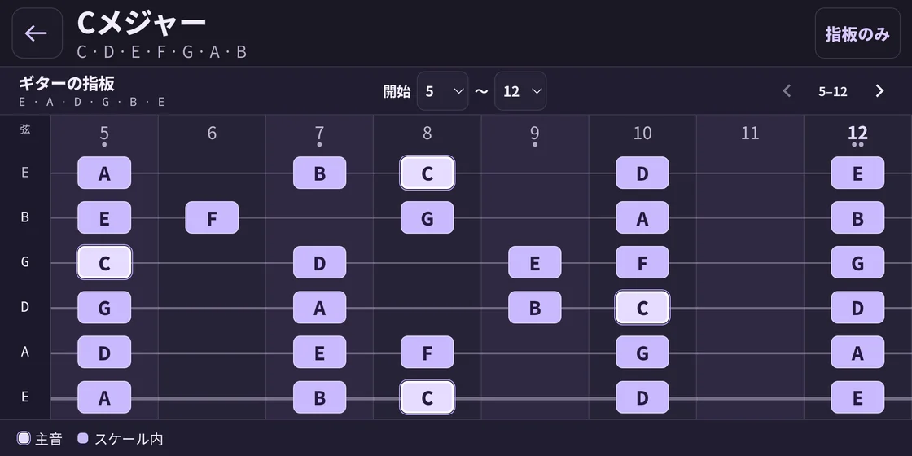
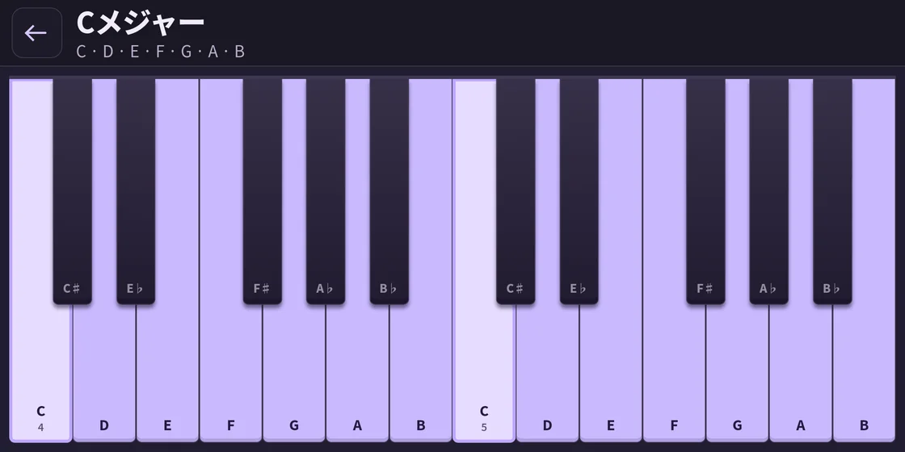
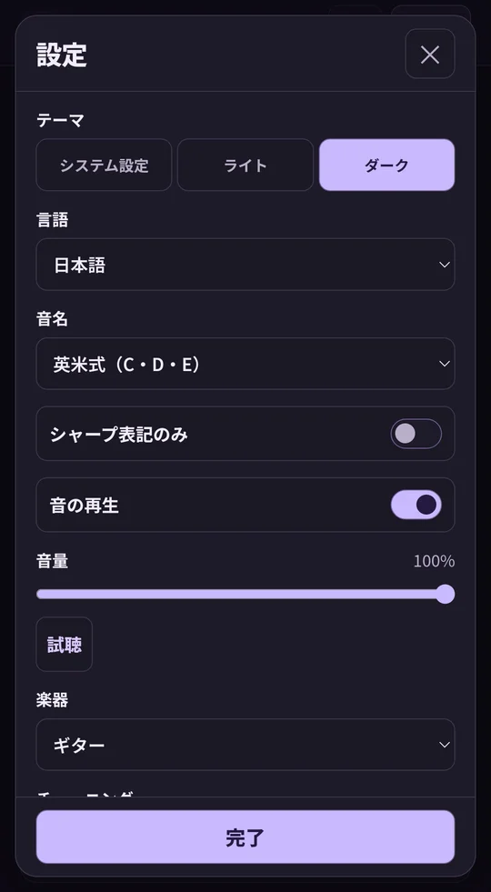
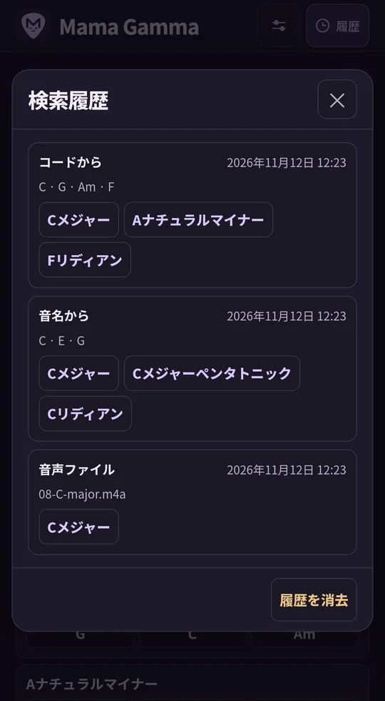

<p align="center">
  
</p>

<p align="center"><a href="../../README.md">English</a> · <a href="README.ru.md">Русский</a> · <a href="README.de.md">Deutsch</a> · <a href="README.es.md">Español</a> · <a href="README.fr.md">Français</a> · <a href="README.uk.md">Українська</a> · <strong>日本語</strong> · <a href="README.zh.md">简体中文</a></p>

# Mama Gamma

音符、コード、音声からスケールを探し、仮想指板やピアノ鍵盤で練習できます。

**バージョン 1.12.0** · Android 8.0 以降 · 端末上で解析

<p align="center">
  <strong><a href="https://github.com/MLEX0/MamaGamma/releases/download/v1.12.0/Mama-Gamma-1.12.0.apk">APK をダウンロード</a></strong> ·
  <a href="https://github.com/MLEX0/MamaGamma/releases/tag/v1.12.0">リリースノート</a>
</p>

## クイックスタート

1. **コードから** を開き、国際式の音名で `C – G – Am – F` と入力します。
2. **スケールを検索** をタップし、**Cメジャー** を選びます。
3. スケール名をダブルタップするか、右側のボタンをタップして指板を全画面で開きます。

<details>
<summary>コード検索のデモを見る</summary>

<p align="center"></p>

</details>

## スケールの検索

- **音名から**。メロディーの音をタップします。音の入力やスケールの表示には **指板** または **ピアノ鍵盤** を選べます。選択した音はすべてのオクターブで強調されます。もう一度タップすると選択が解除されます。候補表示から、次に追加できる音を確認できます。
- **音からコード進行を探す**。**音名から**で音を1つ以上選び、結果を**コード進行**に切り替えます。長音階と自然短音階に基づくコード進行が候補に表示されます。選んだ音は各進行の少なくとも1つのコードに含まれ、該当するコードの下に表示されます。
- **コードから**。`Dm7 | G7 | Cmaj7` のようにコードを入力します。スペース、ダッシュ、縦線、改行で区切れます。完全に一致するスケールが見つからない場合は、近いスケールと、そのスケールに含まれないコードが表示されます。**スケールを検索** で検索した後、結果の **コード進行** を開くと、次に続けられるコードの候補が表示されます。たとえば、`Dm7 – G7` の次に `C` が続く進行です。
- **音声から**。**録音** で演奏を録り、**停止して分析** をタップします。**ファイルを選択** から MP3、WAV、AAC 形式の M4A を開くこともできます。別のアプリからは **共有 → Mama Gamma** を選びます。音声の最初の 20 秒を分析し、長調と短調の候補を最大 3 件表示します。分析後に **コード進行** を開くと、推定した調に合う伴奏のアイデアが表示されます。

<p align="center">
  
  
  
</p>

## 指板と設定

検索結果を 1 回タップすると、メインの指板にスケールが表示されます。全画面では **5–12** などのフレット範囲を指定し、スワイプまたは矢印で指板を動かせます。**指板のみ** で操作パネルと凡例を非表示にできます。**⋯** または Android の **戻る** 操作で表示を戻せます。

<p align="center"></p>

**ピアノ鍵盤** の全画面表示では、スケールの音が鍵盤上で強調されます。

<p align="center">
  
</p>

- **楽器とチューニング**。ギター、ベース、ウクレレ、マンドリンから選べます。開放弦の音と、12〜36 のフレット数を設定できます。
- **音とテーマ**。音量の調整、消音、ライト・ダーク・システムテーマの選択ができます。**試聴** をタップすると、現在のスケールの次の音を再生します。
- **言語**。英語、ロシア語、ドイツ語、スペイン語、フランス語、ウクライナ語、日本語、簡体字中国語に対応しています。既定では Android に設定された対応言語のうち最優先のものを使います。対応言語が設定されていない場合は英語で開きます。
- **音名**。画面の言語とは別に選べます。国際式の **C D E**、ドイツ式の **C D E … H**（**B** は B♭）、イタリア式の **Do Re Mi**、キリル文字の **До Ре Ми**、日本式の **ハ ニ ホ** に対応しています。**シャープ表記のみ**をオンにすると、音名とコードのルート音をシャープで表記します。たとえば E♭ は D♯ と表示されます。
- **履歴**。上部バーから直近 100 件の検索結果を確認できます。スケールをタップすると指板が再び開きます。履歴の消去と設定のリセットはそれぞれ実行できます。

<p align="center">
  
  
</p>

## インストールとビルド

### APK をインストールする

上のリンクから Android 端末に `Mama-Gamma-1.12.0.apk` をダウンロードします。自分でビルドした場合は `app-debug.apk` を端末へ転送します。ファイルを開いて **インストール** を選択し、Mama Gamma を起動します。Android に許可を求められたら、APK を開いたアプリからのインストールを許可します。

### ソースコードから APK をビルドする

**Android SDK Platform 35**、**Android SDK Build-Tools 35.0.0**、**JDK 17** をインストールします。Android Studio でプロジェクトを開くか、`ANDROID_HOME` で SDK の場所を指定します。初回のビルドにはインターネット接続が必要です。 [Android Studio](https://developer.android.com/studio) · [Android Gradle Plugin](https://developer.android.com/build/releases/agp-8-11-0-release-notes)

```sh
git clone https://github.com/MLEX0/MamaGamma.git
cd MamaGamma
```

**Windows PowerShell**

```powershell
.\gradlew.bat :app:assembleDebug
```

**Linux / macOS**

```sh
./gradlew :app:assembleDebug
```

**ビルドした APK** — `app/build/outputs/apk/debug/app-debug.apk`.

<details>
<summary>ADB でインストールする</summary>

USB デバッグを有効にして端末を接続し、端末側で接続を許可します。Android SDK Platform-Tools をインストールした状態で、プロジェクトのルートからコマンドを実行します。

```sh
adb devices
adb install -r app/build/outputs/apk/debug/app-debug.apk
```

</details>

[音声分析に関する調査](../audio-scale-research.md)
