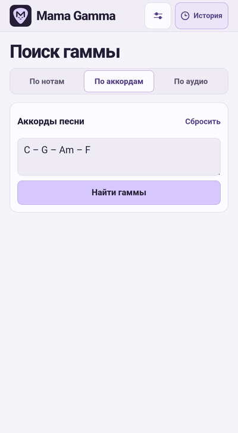
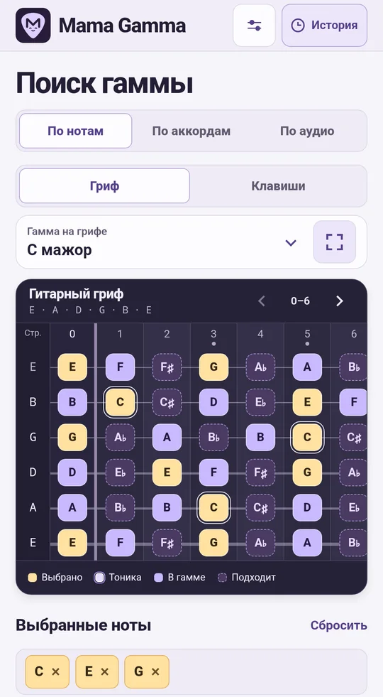
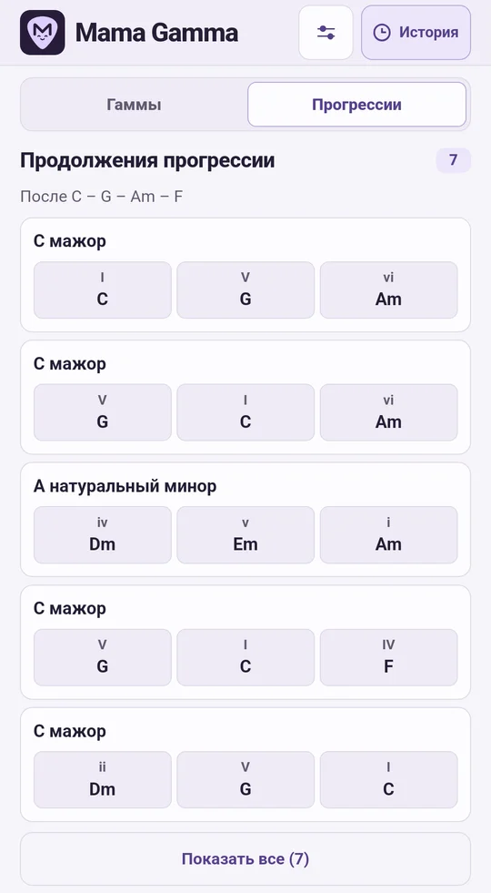
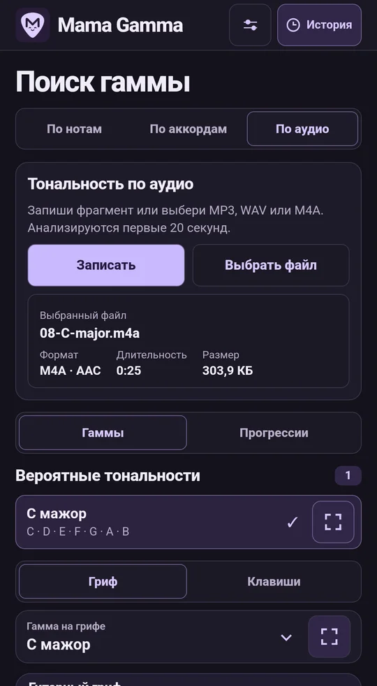
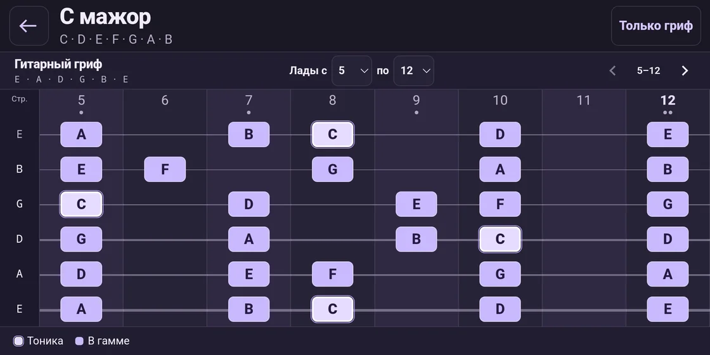
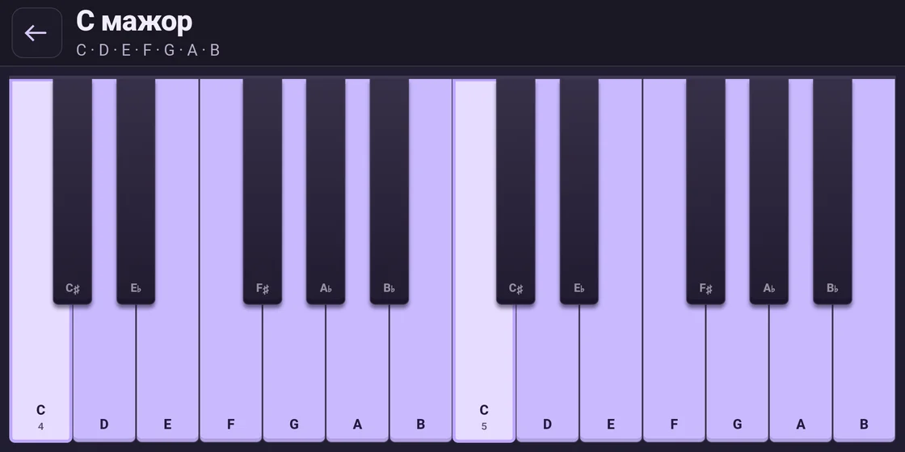
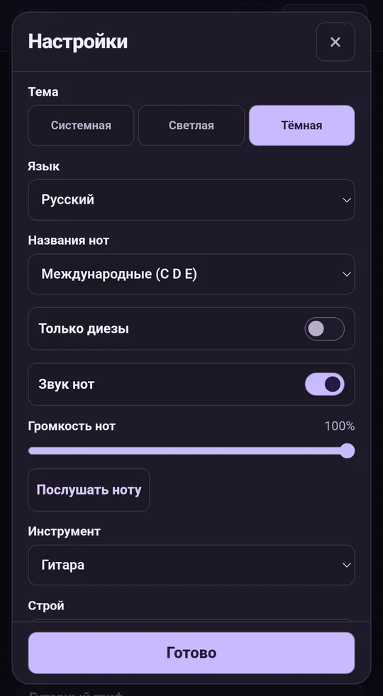
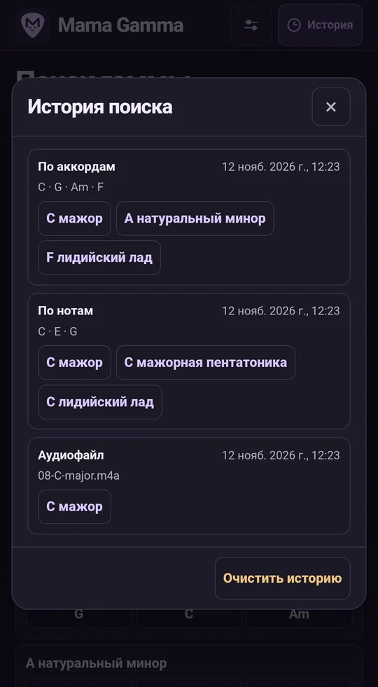

<p align="center">
  
</p>

<p align="center"><a href="../../README.md">English</a> · <strong>Русский</strong> · <a href="README.de.md">Deutsch</a> · <a href="README.es.md">Español</a> · <a href="README.fr.md">Français</a> · <a href="README.uk.md">Українська</a> · <a href="README.ja.md">日本語</a> · <a href="README.zh.md">简体中文</a></p>

# Mama Gamma

Подбирай гаммы по нотам, аккордам и аудио. Играй найденные гаммы на виртуальном грифе или клавишах.

**Версия 1.12.0** · Android 8.0 и новее · Анализ на устройстве

<p align="center">
  <strong><a href="https://github.com/MLEX0/MamaGamma/releases/download/v1.12.0/Mama-Gamma-1.12.0.apk">Скачать APK</a></strong> ·
  <a href="https://github.com/MLEX0/MamaGamma/releases/tag/v1.12.0">Что нового</a>
</p>

## Быстрый старт

1. Открой **По аккордам** и введи `C – G – Am – F` с международными обозначениями нот.
2. Нажми **Найти гаммы** и выбери **C мажор**.
3. Дважды коснись названия гаммы или нажми кнопку справа, чтобы открыть полноэкранный гриф.

<details>
<summary>Посмотреть поиск по аккордам</summary>

<p align="center"></p>

</details>

## Поиск гаммы

- **По нотам.** Коснись нот мелодии. Переключай вид кнопками **Гриф** и **Клавиши**. Выбранная нота подсвечивается во всех октавах. Повторное касание снимает выбор. Подсказки показывают, какие ноты можно добавить.
- **Прогрессии по нотам.** В режиме **По нотам** выбери одну или несколько нот и переключи результаты на **Прогрессии**. Приложение подберёт последовательности аккордов в мажоре и натуральном миноре. Каждая выбранная нота входит хотя бы в один аккорд каждой последовательности и указана под подходящими аккордами.
- **По аккордам.** Введи аккорды, например `Dm7 | G7 | Cmaj7`. Разделяй их пробелами, тире, вертикальными чертами или переносами строк. Если полного совпадения нет, приложение покажет ближайшие гаммы и отметит аккорды вне гаммы. Нажми **Найти гаммы**, затем открой **Прогрессии**, чтобы увидеть варианты продолжения. Например, после `Dm7 – G7` может идти `C`.
- **По аудио.** Запиши отрывок через **Записать** и **Стоп и анализ** или открой MP3, WAV или M4A с кодеком AAC через **Выбрать файл**. Чтобы передать файл из другого приложения, выбери **Поделиться → Mama Gamma**. Анализ первых 20 секунд даёт до трёх вероятных мажорных или минорных тональностей. После анализа открой **Прогрессии**, чтобы посмотреть варианты аккомпанемента в найденных тональностях.

<p align="center">
  
  
  
</p>

## Гриф и настройки

Коснись результата один раз, чтобы подсветить гамму на основном грифе. В полноэкранном режиме укажи диапазон ладов, например **5–12**, и прокручивай гриф свайпом или стрелками. **Только гриф** скрывает панель и легенду. Кнопка **⋯** или системное действие **Назад** возвращает элементы управления.

<p align="center"></p>

В режиме **Клавиши** полноэкранный просмотр выделяет ноты гаммы на клавиатуре.

<p align="center">
  
</p>

- **Инструмент и строй.** Доступны гитара, бас-гитара, укулеле и мандолина. Можно настроить открытые струны и выбрать от 12 до 36 ладов.
- **Звук и тема.** Настрой громкость нот, отключи звук или включи светлую, тёмную либо системную тему. Кнопка **Послушать ноту** проигрывает следующую ступень текущей гаммы.
- **Язык.** Интерфейс доступен на английском, русском, немецком, испанском, французском, украинском, японском и китайском (упрощённом). По умолчанию приложение использует первый поддерживаемый язык Android. Если такого языка нет, используется английский.
- **Названия нот.** Настройка действует независимо от языка интерфейса. Доступны международные **C D E**, немецкие **C D E … H** (**B** означает си-бемоль), латинские **Do Re Mi**, кириллические **До Ре Ми** и японские **ハ ニ ホ**. Включи **Только диезы**, чтобы показывать названия нот и основных тонов аккордов с диезами, например D♯ вместо E♭.
- **История.** В верхней панели можно открыть последние 100 успешных поисков. Выбери гамму, чтобы снова открыть её на грифе. Очистка истории и сброс настроек запускаются отдельно.

<p align="center">
  
  
</p>

## Установка и сборка

### Установить готовый APK

Скачай `Mama-Gamma-1.12.0.apk` по ссылке выше на устройство Android. Если собираешь приложение самостоятельно, перенеси на устройство `app-debug.apk`. Открой файл, нажми **Установить** и запусти Mama Gamma. Если Android запросит разрешение на установку из этого источника, выдай его приложению, через которое открыл APK.

### Собрать APK из исходников

Установи **Android SDK Platform 35**, **Android SDK Build-Tools 35.0.0** и **JDK 17**. Открой проект в Android Studio или укажи путь к SDK через `ANDROID_HOME`. Для первой сборки нужно подключение к интернету. [Android Studio](https://developer.android.com/studio) · [Android Gradle Plugin](https://developer.android.com/build/releases/agp-8-11-0-release-notes)

```sh
git clone https://github.com/MLEX0/MamaGamma.git
cd MamaGamma
```

**Windows PowerShell**

```powershell
.\gradlew.bat :app:assembleDebug
```

**Linux / macOS**

```sh
./gradlew :app:assembleDebug
```

**Готовый APK** — `app/build/outputs/apk/debug/app-debug.apk`.

<details>
<summary>Установка через ADB</summary>

Включи отладку по USB, подключи устройство и подтверди запрос на его экране. Запусти команду из корня проекта с установленными Android SDK Platform-Tools.

```sh
adb devices
adb install -r app/build/outputs/apk/debug/app-debug.apk
```

</details>

[Исследование аудиоанализа](../audio-scale-research.md)
