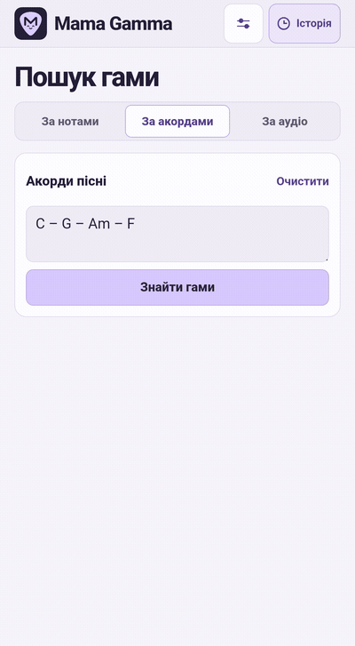
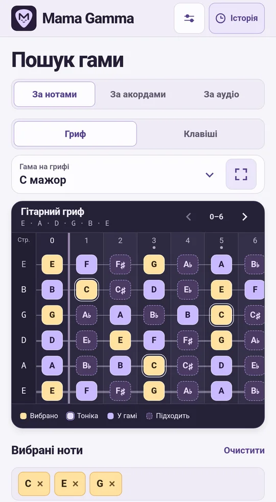
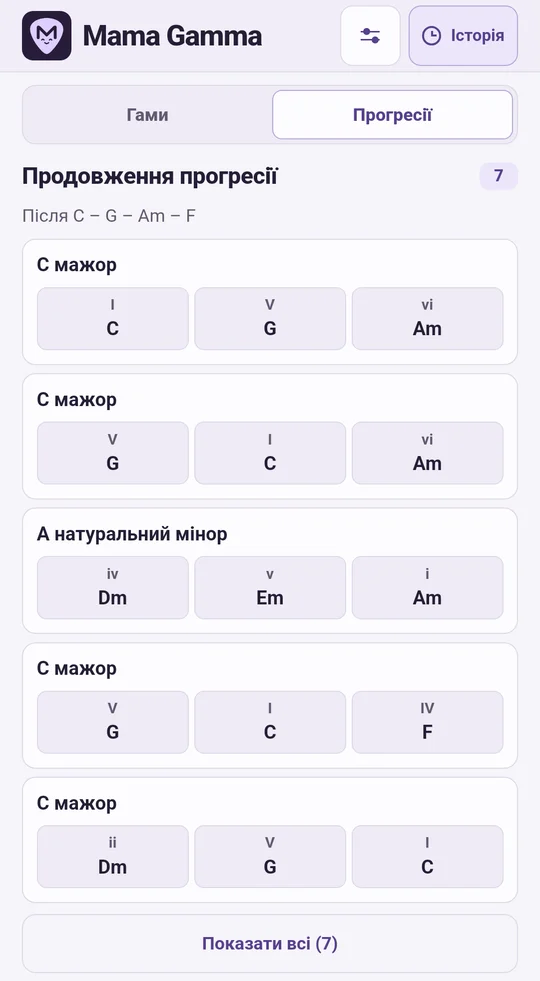
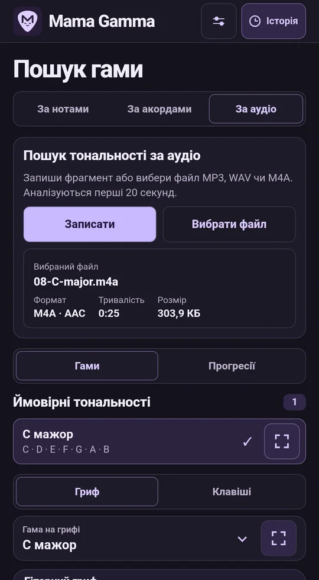
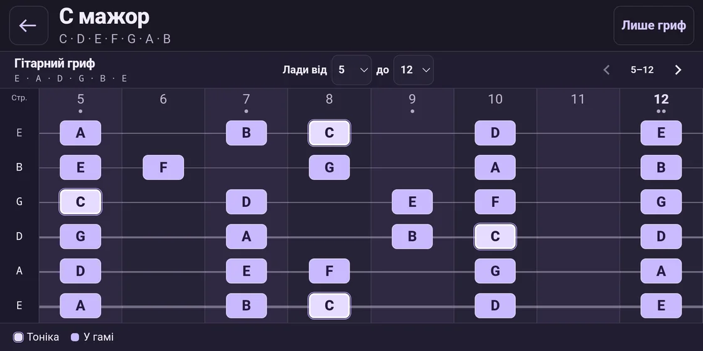
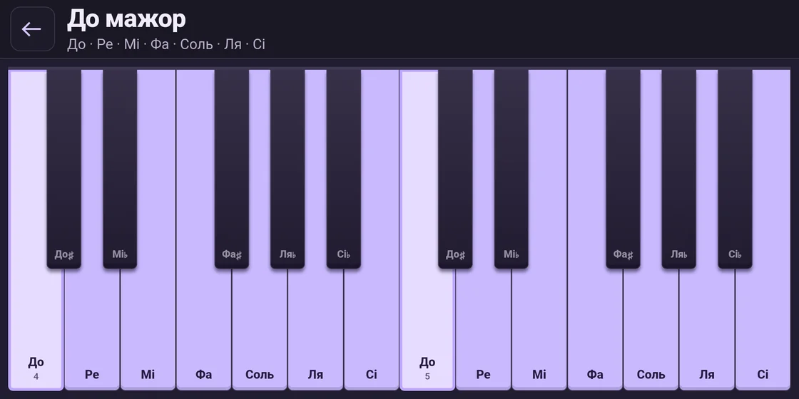
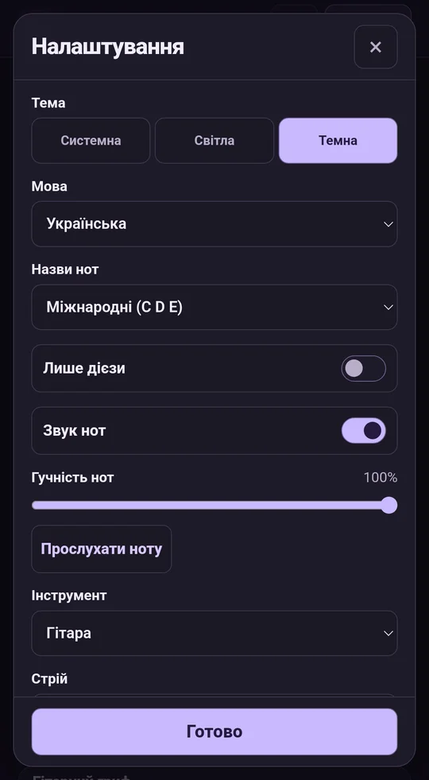
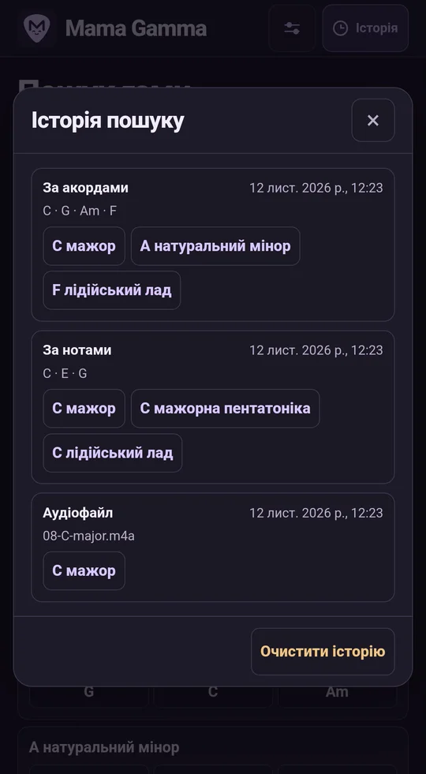

<p align="center">
  
</p>

<p align="center"><a href="../../README.md">English</a> · <a href="README.ru.md">Русский</a> · <a href="README.de.md">Deutsch</a> · <a href="README.es.md">Español</a> · <a href="README.fr.md">Français</a> · <strong>Українська</strong> · <a href="README.ja.md">日本語</a> · <a href="README.zh.md">简体中文</a></p>

# Mama Gamma

Добирай гами за нотами, акордами чи аудіо. Грай знайдені гами на віртуальному грифі або клавішах.

**Версія 1.13.0** · Android 8.0 або новіша версія · Аналіз на пристрої

<p align="center">
  <strong><a href="https://github.com/MLEX0/MamaGamma/releases/download/v1.13.0/Mama-Gamma-1.13.0.apk">Завантажити APK</a></strong> ·
  <a href="https://github.com/MLEX0/MamaGamma/releases/tag/v1.13.0">Що нового</a>
</p>

## Швидкий старт

1. Відкрий **За акордами** й введи `C – G – Am – F` з міжнародними назвами нот.
2. Натисни **Знайти гами** й вибери **C мажор**.
3. Двічі торкнися назви гами або натисни кнопку праворуч, щоб відкрити гриф на весь екран.

<details>
<summary>Переглянути пошук за акордами</summary>

<p align="center"></p>

</details>

## Пошук гам

- **За нотами.** Торкнися нот мелодії. Перемикай вигляд кнопками **Гриф** і **Клавіші**. Вибрана нота виділяється в усіх октавах. Повторний дотик скасовує вибір. Підказки показують, які ноти можна додати.
- **Прогресії за нотами.** У режимі **За нотами** вибери одну або кілька нот і перемкни результати на **Прогресії**. Застосунок запропонує послідовності акордів у мажорі й натуральному мінорі. Кожна вибрана нота входить принаймні до одного акорду в кожній послідовності й відображається під відповідними акордами.
- **За акордами.** Введи акорди, наприклад `Dm7 | G7 | Cmaj7`. Розділяй їх пробілами, тире, вертикальними рисками або переносами рядків. Якщо точного збігу немає, застосунок покаже найближчі гами й позначить акорди поза гамою. Натисни **Знайти гами**, а потім відкрий **Прогресії**, щоб побачити варіанти продовження. Наприклад, після `Dm7 – G7` може йти `C`. Торкнися акорду, щоб почути його й побачити його ноти. **Зіграти прогресію** відтворює послідовність і виділяє поточний акорд.
- **За аудіо.** Натисни **Записати** й стеж за хвилею та таймером під час запису тривалістю до двох хвилин. Натисни **Зупинити й аналізувати**, а потім **Зберегти WAV**, щоб залишити запис. Також можна відкрити MP3, WAV або M4A з AAC через **Вибрати файл** чи передати його з іншого застосунку через **Поділитися → Mama Gamma**.
- **Вибір відрізка.** Перший аналіз охоплює до 20 секунд від початку. Перетягни виділення на хвилі, потягни за край або введи час початку й кінця. Змінюй масштаб кнопками **+** і **−**. Вибери до 20 секунд і натисни **Аналізувати відрізок**. Хвиля довгого файлу з’являється поступово під час декодування.
- **Результати аудіо.** Застосунок показує до трьох імовірних тональностей і послідовність розпізнаних домінантних нот із часовими мітками. Окремий голос або інструмент розпізнається краще. Відкрий **Прогресії** для ідей акомпанементу або натисни **Очистити**, щоб скинути поточний пошук.

<p align="center">
  
  
  
</p>

## Інструменти

Перемикайся між **Пошуком гами** та **Інструментами** в нижній панелі. Результати пошуку зберігаються.

- **Бібліотека акордів.** Знайди акорд за позначенням або вибери основний тон і тип. Вибери басову ноту для обернення. Переглядай і слухай доступні аплікатури для гітари, бас-гітари, укулеле, мандоліни й клавіш. Аплікатури для струнних враховують стрій, а ноти звучать із невеликим зсувом.
- **Тюнер.** Натисни **Увімкнути мікрофон**. Вибери хроматичний режим або струну поточного інструмента. Тюнер показує ноту, частоту й відхилення в центах.

## Гриф і налаштування

Один раз торкнися результату, щоб виділити гаму на основному грифі. У повноекранному режимі вибери діапазон ладів, наприклад **5–12**. Гортай гриф жестом або стрілками. **Лише гриф** приховує панель і легенду. Кнопка **⋯** або системна дія **Назад** повертає елементи керування.

<p align="center"></p>

У режимі **Клавіші** повноекранний перегляд виділяє ноти гами на клавіатурі.

<p align="center">
  
</p>

Кнопка **Зіграти** відтворює гаму до наступної тоніки й виділяє поточну ноту. У налаштуваннях можна вибрати темп від 50 до 180 уд/хв, початкову октаву й діапазон від однієї до п’яти октав. Гортай клавіші або торкнися діапазону октави.

- **Інструмент і стрій.** Вибери гітару, бас-гітару, укулеле або мандоліну. Налаштуй відкриті струни й установи від 12 до 36 ладів.
- **Звук і тема.** Відрегулюй гучність нот, вимкни звук або вибери світлу, темну чи системну тему. Кнопка **Прослухати ноту** відтворює наступний ступінь поточної гами.
- **Мова.** Інтерфейс доступний українською, англійською, німецькою, іспанською, французькою, японською, російською та спрощеною китайською. Застосунок за замовчуванням використовує першу підтримувану мову Android. Якщо такої мови немає, використовується англійська.
- **Назви нот.** Вибираються окремо від мови інтерфейсу. Доступні міжнародні **C D E**, німецькі **C D E … H** (**B** означає сі-бемоль), латинські **Do Re Mi**, кириличні **До Ре Мі** та японські **ハ ニ ホ**. Увімкни **Лише дієзи**, щоб показувати назви нот і основних тонів акордів з дієзами, наприклад D♯ замість E♭.
- **Історія.** На верхній панелі доступні останні 100 успішних пошуків. Торкнися гами, щоб відкрити її знову. Очищення історії та скидання налаштувань виконуються окремо.

<p align="center">
  
  
</p>

## Установлення та збирання

### Установити готовий APK

Завантаж `Mama-Gamma-1.13.0.apk` на пристрій Android за посиланням вище. Якщо ти зібрав застосунок самостійно, перенеси на пристрій `app-debug.apk`. Відкрий файл, натисни **Установити** й запусти Mama Gamma. Якщо Android попросить дозвіл, дозволи встановлення для застосунку, у якому відкриваєш APK.

### Зібрати APK із вихідного коду

Установи **Android SDK Platform 35**, **Android SDK Build-Tools 35.0.0** та **JDK 17**. Відкрий проєкт в Android Studio або вкажи шлях до SDK через `ANDROID_HOME`. Для першого збирання потрібне підключення до інтернету. [Android Studio](https://developer.android.com/studio) · [Android Gradle Plugin](https://developer.android.com/build/releases/agp-8-11-0-release-notes)

```sh
git clone https://github.com/MLEX0/MamaGamma.git
cd MamaGamma
```

**Windows PowerShell**

```powershell
.\gradlew.bat :app:assembleDebug
```

**Linux / macOS**

```sh
./gradlew :app:assembleDebug
```

**Готовий APK** — `app/build/outputs/apk/debug/app-debug.apk`.

<details>
<summary>Установлення через ADB</summary>

Увімкни налагодження через USB, під’єднай пристрій і підтвердь запит на його екрані. Виконай команду з кореня проєкту, попередньо встановивши Android SDK Platform-Tools.

```sh
adb devices
adb install -r app/build/outputs/apk/debug/app-debug.apk
```

</details>

[Дослідження аналізу аудіо](../audio-scale-research.md)
