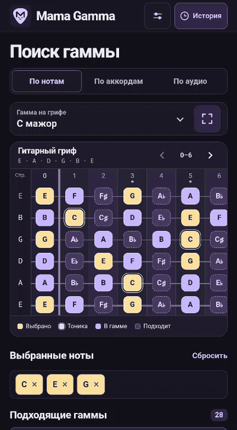
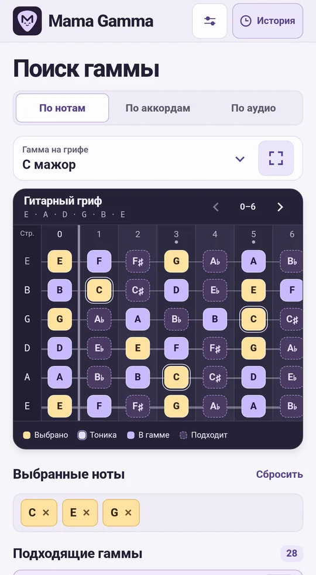
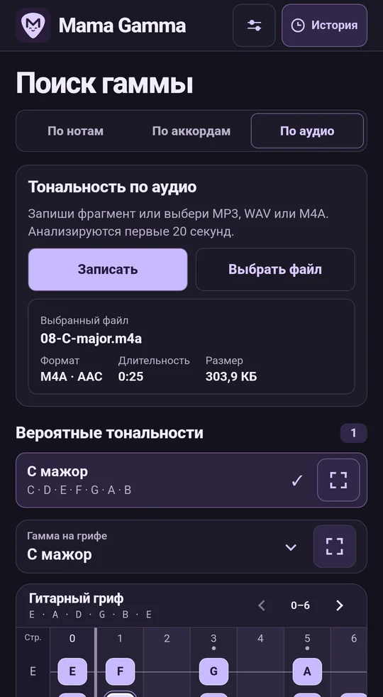
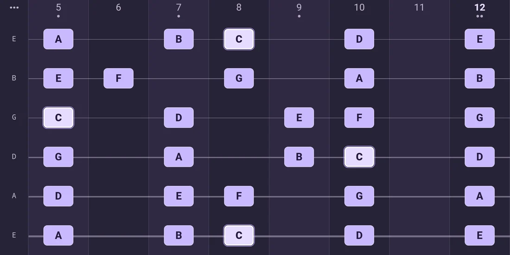
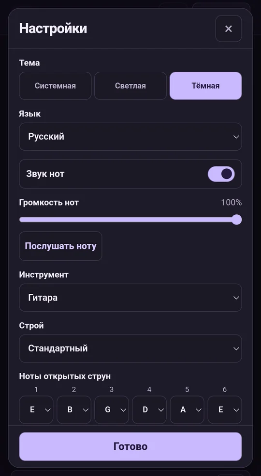
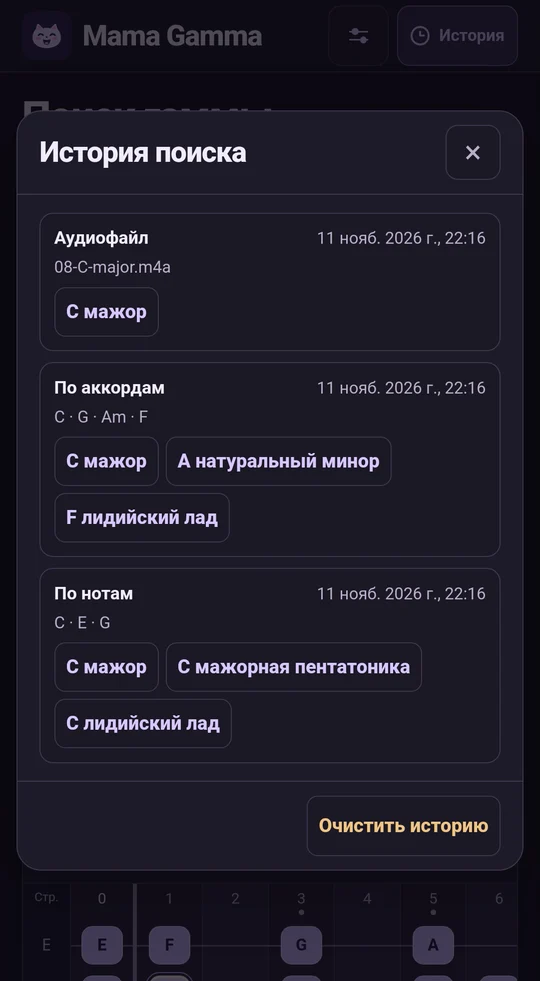

<p align="center">
  
</p>

<p align="center"><a href="../../README.md">English</a> · <a href="README.ru.md">Русский</a> · <a href="README.de.md">Deutsch</a> · <a href="README.es.md">Español</a> · <a href="README.fr.md">Français</a> · <strong>Українська</strong> · <a href="README.ja.md">日本語</a></p>

# Mama Gamma

Добирай гами за нотами, акордами чи аудіо. Розучуй знайдені гами на віртуальному грифі.

**Версія 1.9.0** · Android 8.0 або новіша версія · Аналіз на пристрої

## Швидкий старт

1. Відкрий **За акордами** й введи `C – G – Am – F` з міжнародними назвами нот.
2. Натисни **Знайти гами** й вибери **C мажор**.
3. Двічі торкнися назви гами або натисни кнопку праворуч, щоб відкрити гриф на весь екран.

<details>
<summary>Переглянути пошук за акордами</summary>

<p align="center"></p>

</details>

## Пошук гам

- **За нотами.** Торкнися нот мелодії на грифі. Вибрана нота виділяється в усіх октавах. Повторний дотик скасовує вибір. Підказки показують, які ноти можна додати.
- **За акордами.** Введи акорди, наприклад `Dm7 | G7 | Cmaj7`. Розділяй їх пробілами, тире, вертикальними рисками або переносами рядків. Якщо точного збігу немає, застосунок покаже найближчі гами й позначить акорди поза гамою.
- **За аудіо.** Запиши фрагмент через **Записати** й **Зупинити й аналізувати**. Можна також відкрити MP3, WAV або M4A з кодеком AAC через **Вибрати файл**. Щоб надіслати файл з іншого застосунку, вибери **Поділитися → Mama Gamma**. За першими 20 секундами аудіо застосунок визначає до трьох імовірних мажорних або мінорних тональностей.

На знімках екрана показано російський інтерфейс.

<p align="center">
  
  
</p>

## Гриф і налаштування

Один раз торкнися результату, щоб виділити гаму на основному грифі. У повноекранному режимі вибери діапазон ладів, наприклад **5–12**. Гортай гриф жестом або стрілками. **Лише гриф** приховує панель і легенду. Кнопка **⋯** або системна дія **Назад** повертає елементи керування.

<p align="center"></p>

- **Інструмент і стрій.** Вибери гітару, бас-гітару, укулеле або мандоліну. Налаштуй відкриті струни й установи від 12 до 36 ладів.
- **Звук і тема.** Відрегулюй гучність нот, вимкни звук або вибери світлу, темну чи системну тему. Кнопка **Прослухати ноту** відтворює наступний ступінь поточної гами.
- **Мова.** Інтерфейс доступний українською, англійською, німецькою, іспанською, французькою, японською та російською. Застосунок за замовчуванням використовує першу підтримувану мову Android. Якщо такої мови немає, використовується англійська.
- **Назви нот.** Вибираються окремо від мови інтерфейсу. Доступні міжнародні **C D E**, німецькі **C D E … H** (**B** означає сі-бемоль), латинські **Do Re Mi**, кириличні **До Ре Мі** та японські **ハ ニ ホ**.
- **Історія.** На верхній панелі доступні останні 100 успішних пошуків. Торкнися гами, щоб відкрити її знову. Очищення історії та скидання налаштувань виконуються окремо.

<p align="center">
  
  
</p>

## Установлення та збирання

### Установити готовий APK

Перенеси `Mama Gamma.apk` або зібраний `app-debug.apk` на Android. Відкрий файл, натисни **Установити** й запусти Mama Gamma. Якщо Android попросить дозвіл, дозволи встановлення для застосунку, у якому відкриваєш APK.

### Зібрати APK із вихідного коду

Установи **Android SDK Platform 35**, **Android SDK Build-Tools 35.0.0** та **JDK 17**. Відкрий проєкт в Android Studio або вкажи шлях до SDK через `ANDROID_HOME`. Для першого збирання потрібне підключення до інтернету. [Android Studio](https://developer.android.com/studio) · [Android Gradle Plugin](https://developer.android.com/build/releases/agp-8-11-0-release-notes)

```sh
git clone https://github.com/MLEX0/GammaMama.git
cd GammaMama
```

**Windows PowerShell**

```powershell
.\gradlew.bat :app:assembleDebug
```

**Linux / macOS**

```sh
./gradlew :app:assembleDebug
```

**Готовий APK** — `app/build/outputs/apk/debug/app-debug.apk`.

<details>
<summary>Установлення через ADB</summary>

Увімкни налагодження через USB, під’єднай пристрій і підтвердь запит на його екрані. Виконай команду з кореня проєкту, попередньо встановивши Android SDK Platform-Tools.

```sh
adb devices
adb install -r app/build/outputs/apk/debug/app-debug.apk
```

</details>

[Дослідження аналізу аудіо](../audio-scale-research.md)
