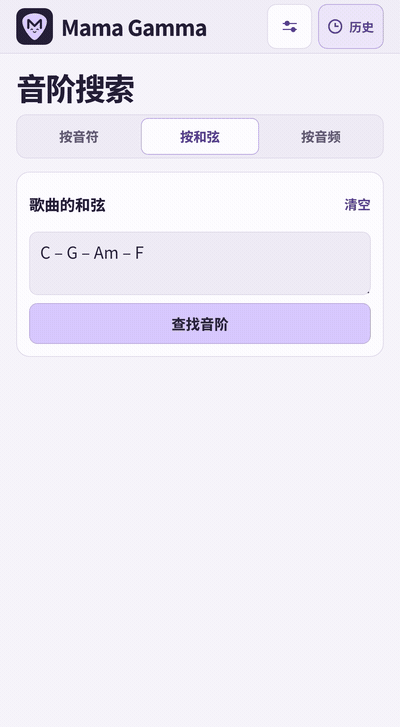
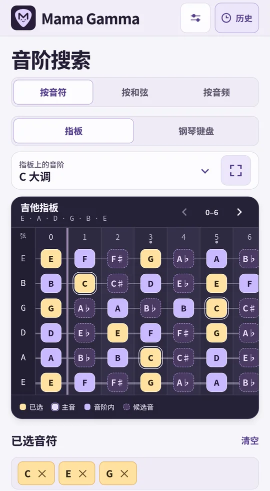
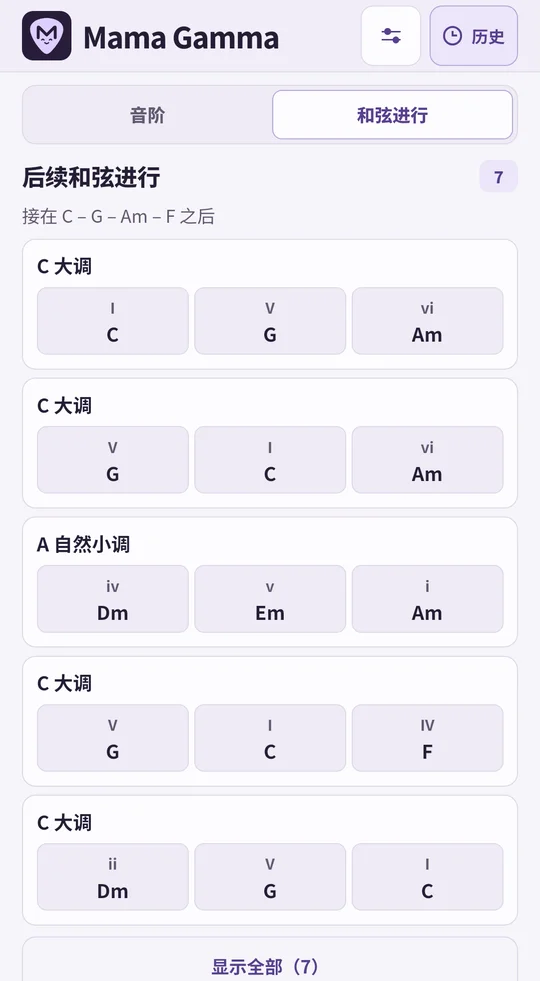
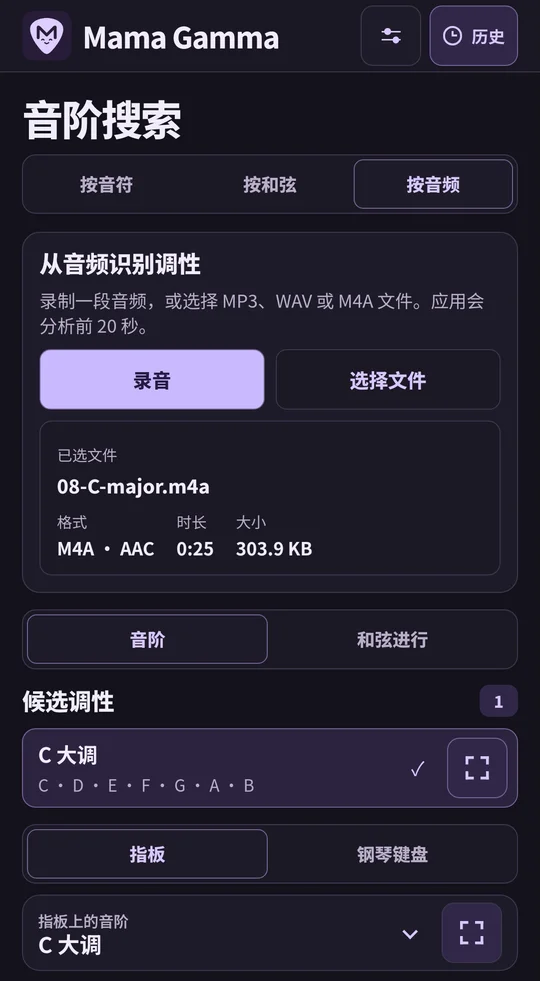
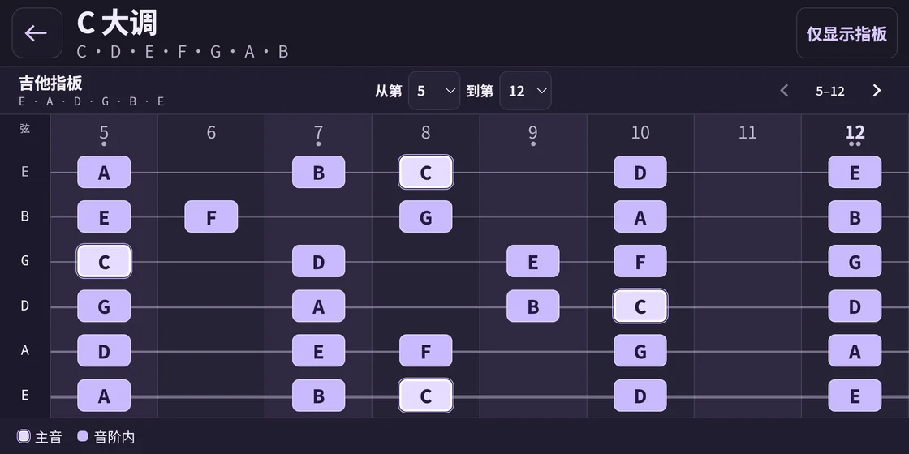
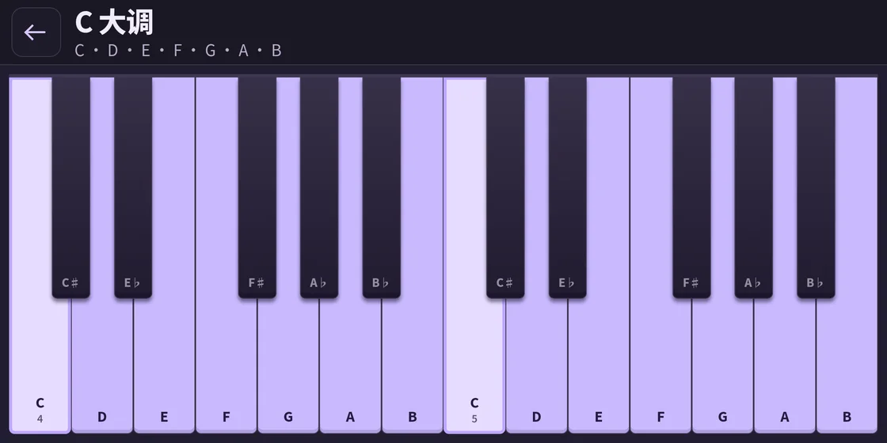
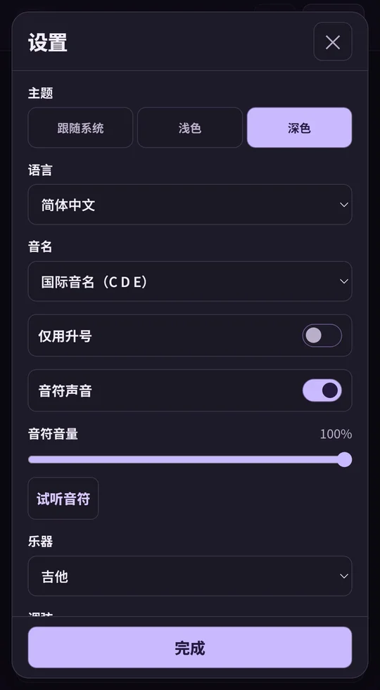
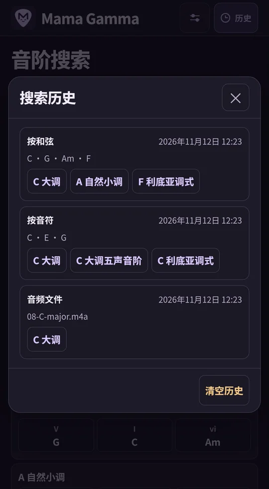

<p align="center">
  
</p>

<p align="center"><a href="../../README.md">English</a> · <a href="README.ru.md">Русский</a> · <a href="README.de.md">Deutsch</a> · <a href="README.es.md">Español</a> · <a href="README.fr.md">Français</a> · <a href="README.uk.md">Українська</a> · <a href="README.ja.md">日本語</a> · <strong>简体中文</strong></p>

# Mama Gamma

根据音符、和弦或音频查找音阶，并在虚拟指板或钢琴键盘上练习。

**版本 1.11.0** · Android 8.0 或更高版本 · 端侧分析

<p align="center">
  <strong><a href="https://github.com/MLEX0/MamaGamma/releases/download/v1.11.0/Mama-Gamma-1.11.0.apk">下载 APK</a></strong> ·
  <a href="https://github.com/MLEX0/MamaGamma/releases/tag/v1.11.0">版本说明</a>
</p>

## 快速开始

1. 打开 **按和弦**，按国际音名输入 `C – G – Am – F`。
2. 点击 **查找音阶**，在结果中选择 **C 大调**。
3. 双击音阶名称或点击右侧的展开按钮，即可横屏查看。

<details>
<summary>观看和弦搜索演示</summary>

<p align="center"></p>

</details>

## 查找音阶与和弦进行

- **按音符。** 在 **指板** 与 **钢琴键盘** 之间切换，然后点选旋律中的音符。选中的音符会在所有八度中高亮。再次点击即可取消选择，提示会标出还能加入的音符。切换到 **和弦进行** 可查看大调与自然小调的进行建议。每条建议都包含所有选中的音符，并在相应和弦下标出这些音符。
- **按和弦。** 输入 `Dm7 | G7 | Cmaj7` 等和弦，可用空格、短横线、竖线或换行分隔。如果没有完全匹配的音阶，应用会显示最接近的音阶，并标出其中不包含的和弦。点击 **查找音阶** 后，在结果中打开 **和弦进行**，查看后续和弦的建议。例如，`Dm7 – G7` 之后可以接 `C`。
- **按音频。** 点击 **录音** 录制片段，再点击 **停止并分析**。也可用 **选择文件** 打开 MP3、WAV 或采用 AAC 编码的 M4A 文件，或者从其他应用使用 **分享 → Mama Gamma**。应用分析音频开头最多 20 秒，提供至多三个可能的大调或小调调性。分析完成后打开 **和弦进行**，可查看适合这些调性的伴奏建议。

<p align="center">
  
  
  
</p>

## 乐器视图与设置

点击搜索结果，在当前的指板或钢琴键盘上查看音阶。全屏指板支持选择品位范围，例如 **5–12**，并可滑动或使用箭头移动。点击 **仅显示指板** 可隐藏工具栏和图例，点击 **⋯** 或使用 Android 的 **返回** 操作可恢复控件。

<p align="center"></p>

在 **钢琴键盘** 模式中，全屏视图会在键盘上高亮音阶中的音符。

<p align="center">
  
</p>

- **乐器与调弦。** 可选吉他、贝斯、尤克里里或曼陀林。可以调整空弦音高，并设置 12 到 36 个品位。
- **声音与主题。** 可调节音符音量、静音，或选用浅色、深色和系统主题。点击 **试听音符** 会播放当前音阶的下一个音。
- **语言。** 支持英语、俄语、德语、西班牙语、法语、乌克兰语、日语和简体中文。默认采用 Android 语言列表中第一个受支持的语言，如果都不受支持则使用英语。
- **音名。** 可独立于界面语言选择国际音名 **C D E**、德式音名 **C D E … H**（**B** 表示降 B）、唱名 **Do Re Mi**、西里尔字母唱名 **До Ре Ми** 或日式音名 **ハ ニ ホ**。打开 **仅用升号** 后，音名和和弦根音会以升号表示同音异名，例如将 E♭ 写为 D♯。
- **历史。** 在顶部栏打开最近 100 次有结果的搜索。点按音阶可再次打开。**清空历史**与重置设置是两项独立操作。

<p align="center">
  
  
</p>

## 安装与构建

### 安装 APK

通过上方链接将 `Mama-Gamma-1.11.0.apk` 下载到 Android 设备。如果自行构建了应用，请将 `app-debug.apk` 传到设备。打开文件，点击 **安装**，然后启动 Mama Gamma。如果 Android 提示授权，请允许用于打开 APK 的应用安装该文件。

### 从源代码构建 APK

安装 **Android SDK Platform 35**、**Android SDK Build-Tools 35.0.0** 和 **JDK 17**。用 Android Studio 打开项目，或设置 `ANDROID_HOME` 指向 SDK 目录。首次构建需要联网下载依赖。 [Android Studio](https://developer.android.com/studio) · [Android Gradle Plugin](https://developer.android.com/build/releases/agp-8-11-0-release-notes)

```sh
git clone https://github.com/MLEX0/MamaGamma.git
cd MamaGamma
```

**Windows PowerShell**

```powershell
.\gradlew.bat :app:assembleDebug
```

**Linux / macOS**

```sh
./gradlew :app:assembleDebug
```

构建生成的 APK 位于 `app/build/outputs/apk/debug/app-debug.apk`。

<details>
<summary>使用 ADB 安装</summary>

开启 USB 调试，连接设备并在设备上确认授权。安装 Android SDK Platform-Tools 后，在项目根目录运行以下命令。

```sh
adb devices
adb install -r app/build/outputs/apk/debug/app-debug.apk
```

</details>

[音频分析研究笔记（俄语）](../audio-scale-research.md)
